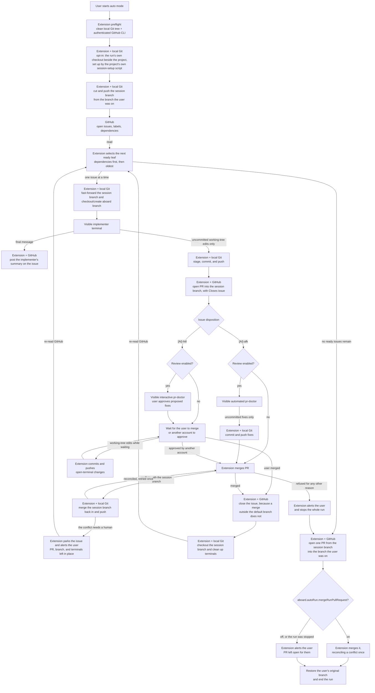

# AGENTS.md

## Project Shape

**aboard** is a VS Code extension for Claude Code. It replaces opaque in-process delegation with visible, independent Claude Code terminals coordinated by one long-lived Manager. Users can watch, interrupt, resume, or take over every session.

### Typical User Flow

Initialize a repository -> start or resume the Manager -> discuss and approve work -> the Manager delegates to visible worker terminals -> inspect or take over those terminals when useful -> keep durable plans and implementation state in GitHub -> optionally run the issue implementation loop.

### Core Product Philosophy

The goal is experience, not maximum automation. The human stays involved in every decision that matters. A change that hides work or removes user judgement is a regression, even when it saves time or tokens.

Design priorities:

1. Visibility over efficiency.
2. Structure over prompt instructions. Enforce behavior with tool sets, leases, and derived state.
3. Derive facts instead of storing duplicates.
4. Keep durable work state in GitHub or committed files.
5. Treat the bridge as the only entry point for aboard agents.
6. Use the cheapest sufficient mechanism: hook, tool call, reasoning turn, then agent.

### Communication Flow

```text
User <-> VS Code UI and terminals <-> extension host
                                      |-- domain state
                                      |-- authenticated loopback bridge and Manager MCP
                                      |-- Claude Code launches, hooks, sessions, and resume
                                      `-- git and GitHub boundaries
```

## Sources of Truth

- Existing runtime code, tests, and scaffold assets are the authority for implementation behavior. Read them before changing a boundary; do not reproduce their algorithms, CLI argument ordering, route payloads, timeouts, or state machines here.
- `docs/configuration.md` is the user-facing settings reference.
- `docs/CLAUDE-REFERENCES/` contains the checked-in Claude Code documentation. Verify CLI, agent, tool, settings, skill, and hook behavior there instead of relying on memory.
- This file summarizes product intent and load-bearing constraints. Keep it concise. When behavior changes, update code and focused tests; update this file only when the project shape or an architectural constraint changes.

## Repository Layout

> One npm package; no workspace or monorepo tooling.

- `src/extension.ts`: activation and composition root
- `src/domain/`: pure fleet, lease, session, roadmap, failure, and auto-run state
- `src/bridge/`: authenticated HTTP/MCP surface, hooks, lifecycle, and terminal routes
- `src/claude/`: launch planning, prompts, terminals, sessions, resume, and transcript backup
- `src/auto/`: automatic implementation driver
- `src/git/`: git boundary
- `src/github/`: GitHub CLI, issue, roadmap, and review boundaries
- `src/runtime/`: ephemeral persisted-state boundaries
- `src/vscode/`: commands, fleet view, status bar, notifications, and native UI
- `src/scaffold/`: project initialization and scaffold upgrades
- `src/shared/`: small cross-boundary types and utilities
- `assets/scaffold/`: versioned project assets copied into initialized repositories
- `test/`: unit and boundary-focused integration tests
- `docs/`: settings documentation and Claude Code reference snapshots

## Tech Stack

- VS Code extension API, using real terminals created through `window.createTerminal()`
- TypeScript in strict mode
- Node.js 24 for local tooling; bundled output targets Node.js 22
- esbuild, CommonJS output
- npm 11
- Node's test runner
- Python hook and wrapper assets executed through `uv`
- Git and GitHub CLI for durable work state and repository operations

## Important Constraints & Requirements

### Architecture and Security Boundaries

- Keep domain code independent from VS Code, HTTP, subprocess, filesystem, clock, and GitHub CLI details. Boundary modules may depend on domain contracts; never the reverse.
- Parse and validate untrusted data at process, HTTP/MCP, hook, configuration, and persisted-file boundaries.
- The bridge runs in the extension host, binds only to `127.0.0.1`, and requires a new bearer token for every activation and every request.
- The bridge is the only creator of aboard agents. Hand-started Claude Code sessions are deliberately outside the fleet.
- Never log or commit tokens, prompts, transcripts, session data, or other `.aboard/runtime/` contents. Bridge discovery and Manager MCP configuration containing credentials live in VS Code extension storage, outside the workspace.
- `.aboard/scaffold.json` is the sole initialized-project signal. Side-effecting commands must also enforce initialization at runtime; VS Code `when` clauses are visibility controls, not authorization.
- Use native VS Code and Node APIs unless a new dependency has a demonstrated need. Do not introduce a database, UI framework, DI container, web framework, or separate bridge process speculatively.
- Assume one workspace root and GitHub as the only durable backend.

### Agent Isolation and Launches

- Authored aboard definitions live in `.aboard/agents/`, never `.claude/agents/`. Each defined launch receives an isolated rewritten definition under `.aboard/runtime/`; no aboard worker may become discoverable by unrelated Claude sessions.
- An aboard agent definition is the authority for that role's whole system prompt and tools. Capability and write access are derived from the effective tool set, never from a second manual flag.
- `Explore` remains Claude Code's built-in read-only agent with metadata-only launch policy. `general-purpose` remains an unmodified default Claude Code session. Do not reconstruct either as an aboard definition.
- The aboard MCP server is exposed only to the Manager through per-launch configuration stored outside the workspace. Never register it in `.mcp.json`, agent frontmatter, or another project-scoped location, and never widen the Manager-only caller check.
- Start and resume must preserve the same launch policy, including isolated definitions, capability limits, model/effort policy, Chrome intent, and Manager MCP access.
- Resolve an automated worker's context before launch and pass its first prompt as a CLI argument. Never inject an automated prompt by typing into a live TUI.
- Claude in Chrome is explicit user intent, never an agent default. It is available only to `general-purpose` sessions and auto-run implementers, and that intent must survive resume.
- Every project-scoped hook first guards on `ABOARD_AGENT_ID`; role-specific hooks also guard on `ABOARD_AGENT_TYPE`. A hook not addressed to the current session exits successfully and silently.

### Human Control and Write Safety

- The Manager orchestrates, maintains continuity, and delegates. It does not implement or edit application code and cannot use Claude Code's in-process agent or session-task tools.
- At most one aboard-driven, write-capable agent may hold the write lease. Write capability is derived from tools.
- The lease protects work aboard drives, not work the user drives. Automated Manager launches and every auto-run launch compete for it; ordinary interactive launches, restores, resumes, and hand-driven sessions do not.
- Session completion releases aboard state without hiding the terminal by default. Users may keep, inspect, reuse, close, reopen, or restore sessions through visible VS Code controls.
- Automated review is opt-in. aboard never approves its own pull requests.

### Agent Roles

| Role | Purpose | Reachability |
| :-- | :-- | :-- |
| `manager` | Long-lived project continuity, planning, and delegation; never implementation | User starts or resumes it |
| `brainstormer` | Interactive discovery that produces an implementation-ready durable specification | Manager or user workflow |
| `webresearcher` | Non-interactive research of current external facts with citations | Delegated research only |
| `implementer` | Implements one resolved issue and leaves changes uncommitted | Auto-run only |
| `pr-doctor-afk` | Reviews and directly fixes an implementation when unattended review is allowed | Auto-run or `review_pr` |
| `pr-doctor-hitl` | Reports findings, waits for the user, then applies only approved fixes | Auto-run or `review_pr` |
| `Explore` | Built-in read-only repository exploration | Delegated exploration only |
| `general-purpose` | Claude Code's unmodified default session, interactive or result-delivering | Manager or user workflow |

The scaffolded definitions are the detailed authority for role prompts, tool allowlists, models, effort, and colors. Keep automated worker prompts self-sufficient. The Manager cannot directly launch `implementer` or either pr-doctor.

### GitHub Work Model

- GitHub issues and pull requests are the durable work-state source. Do not introduce a local `TODO.md` or duplicate issue/PR state.
- Preserve exactly four aboard labels: `[AI]-spec`, `[AI]-todo`, `[AI]-afk`, and `[AI]-hitl`. The former `ai:*` labels and unprefixed equivalents are ordinary user labels; do not recognize or migrate them.
- The roadmap is an open GitHub issue labelled `[AI]-todo`, using a flat Markdown checkbox list whose order is priority. Other issue and PR states are derived from GitHub.
- `[AI]-afk` work may merge unattended into a run's session branch. `[AI]-hitl` normally waits for the user's merge; approval from another account also permits the extension to merge. An issue with neither disposition is legitimate but must not be guessed.
- GitHub closes a linked issue only when its pull request merges into the default branch. Nothing aboard automates merges there, so any closure aboard depends on is one aboard performs explicitly.

### Auto Mode Flow

The diagram shows ownership, not the reducer's exact phase logic. The current code remains authoritative.



- The extension owns every automatic git and GitHub side effect: branch, commit, push, issue comment, issue closure, pull request, and merge. Implementers and pr-doctors leave edits uncommitted and never run `gh` or mutating git workflow commands.
- A run never merges into the repository's default branch, and never moves a branch the user owns. It cuts one session branch, `aboard/run/<run id>`, from the branch the user was on; every issue branch is cut from and merged into that; and the run's one pull request from it into the user's branch is the only place a run touches something a human is working on. The session branch is derived from the run id and the target from the recorded return branch, so neither is stored twice. A detached HEAD is the only case where the default branch stands in as the target.
- The extension closes each issue as its pull request merges into the session branch. GitHub only honours a closing keyword for a merge into the default branch, so without this every issue would stay open — leaving dependents blocked, the roadmap wrong, and a resumed run free to implement the same issue twice. A closure that fails is reported and survived, never allowed to fail work that merged.
- The run's own pull request is opened on every exit, including a stop or an abort, whenever at least one issue landed: work on the session branch is invisible until something points at it. Merging it is opt-in through `aboard.autoRun.mergeRunPullRequest` and is never attempted for a run the user interrupted. It merges without deleting the session branch, because parked and unmerged issue pull requests still target it.
- An agent's final message is content, never a side effect. The extension is what publishes it: as the commit body, as the pull request body, and as a comment on the issue the implementer resolved. Publishing it is best-effort and carries no postcondition.
- Auto-run re-observes git and GitHub before each phase and after every issue. The persisted record is only a resume hint; every phase is idempotent and skips an already-satisfied postcondition.
- Review stays opt-in. An AFK pull request may be merged into the session branch directly; a HITL pull request requires the user's merge or another account's approval. The extension never attempts self-approval.
- A merge conflict is a fact about one branch, so it parks that issue and the run continues. Anything else that refuses a merge — branch protection above all — is a fact about the repository, so it stops the run. Parking never closes or abandons anything: the pull request, branch, and terminals stay as they are for the user.
- A run that needs the user's hands says so immediately rather than only queueing a line for the Manager, because a parked or stopped run no longer owns any visible progress indicator.
- Opt-in, a run works in a checkout of its own instead of the user's: a git worktree created beside the project root, never inside it, with the leaf named after the repository so it reads as an ordinary clone from the inside. Nothing about the path announces what it is. In that mode the run's whole git surface is that checkout, the user's HEAD and working tree are never touched — so the clean-tree precondition and the end-of-run branch restore both fall away — and every agent is launched with it as its working directory. The path is derived from the run id, so it is never stored.
- That isolation is a convention with a fence, not a sandbox. Launches carry `Read`/`Edit` deny rules covering the project root, which stops the accident; `Bash` reaches the whole filesystem and aboard does not try to police shell commands. Do not present it as a security boundary, and do not add command-level guessing to make it look like one.
- A second checkout holds only what git tracks, so it requires aboard's hook registration to be committed, and it needs the project's own `.aboard/session-setup.*` to become usable. Both are preconditions checked before any agent starts: a run must never discover a missing hook one dead worker at a time.
- A checkout the run created is removed when its queue drains and kept whenever the user was sent to look at something in it — a stop, an abort, or a parked issue. Removal is best-effort: a shell still sitting in the directory is the normal reason it fails, and the path is reported rather than the failure escalated.

### Scaffold and State Ownership

- Scaffold templates are assets, not runtime source. Do not create placeholder directories or abstractions before their first real use.
- Preserve user settings and unrelated MCP servers. aboard may merge its hook registrations into `.claude/settings.json`, but it never writes `permissions`, `autoCompact`, or a `CLAUDE.md`.
- The extension owns only files recorded by its scaffold manifest. Upgrade unchanged owned files and warn instead of overwriting locally edited files.
- User-owned skills and hooks installed from upstream remain upstream-owned. Do not copy, rewrite, or silently replace them inside aboard.
- Durable project state belongs in GitHub or committed files. Ephemeral fleet, session, auto-run, lock, prompt, agent-rewrite, event, and transcript state belongs under gitignored `.aboard/runtime/`. A launch's own runtime files are written under the directory that launch runs in, because its command line references them relatively.

## Commands

From the project root:

```powershell
npm install

npm run check             # strict TypeScript typecheck
npm run build             # bundle the extension
npm test                  # unit and boundary integration tests
npm run test:vscode       # VS Code activation and native UI integration
npm run test:integration  # standard tests plus VS Code integration
npm run package           # verify and build the VSIX
```

`npm run package` is the packaging gate. It checks runtime files and scaffold assets and rejects private runtime state or source/test files from the VSIX.

## Tests

- Add focused tests with every behavior change.
- Prefer pure unit tests for domain reducers, fleet, lease, session, roadmap, and failure transitions.
- Test boundary parsing, authentication, launch construction, scaffold merging, persistence, git/GitHub adapters, and resume behavior with injected adapters.
- Test Python hooks as standalone stdin/environment programs, including their silent guard paths.
- Keep the VS Code integration suite small and focused on activation, command wiring, terminal creation, and native UI.
- Assert behavior and structure, not authored prompt prose, error wording, or MCP description wording.
- Do not run an end-to-end aboard workflow in this repository; it would create real GitHub state and modify project settings. Use a throwaway repository when end-to-end testing is explicitly needed.

## Development Style

- Keep TypeScript strict. Avoid `any`; use `unknown` and validation at untrusted boundaries.
- Model protocols, failures, lifecycle states, and agent types explicitly. Prefer discriminated unions over combinations of booleans.
- Keep modules focused and global mutable state in the composition root.
- Make cleanup explicit: dispose VS Code registrations, close servers, stop polls, and release resources.
- Support Windows paths and PowerShell as first-class environments. Do not assume POSIX shell syntax or `/tmp`.
- Do not log bearer tokens, complete environments, sensitive prompts, or transcripts.
- Use comments for invariants and non-obvious tradeoffs, not to narrate straightforward code.
- Prefer the smallest complete change. Do not add speculative abstractions or backward-compatibility shims without a real requirement.

## Useful References

- `README.md`: product overview and user workflow
- `CONTRIBUTING.md`: development setup, verification, and safe manual testing
- `docs/configuration.md`: authoritative `aboard.*` settings reference
- `docs/CLAUDE-REFERENCES/README.md`: index of checked-in Claude Code documentation snapshots

## Current Project State

aboard is pre-1.0 but the runtime works end to end. The automatic implementation workflow is implemented. APIs, settings, and scaffold assets may still change; keep the current code in its optimal shape instead of preserving obsolete internal behavior without a demonstrated compatibility need.

## Common Mistakes to Avoid

- Treating this summary as more current than the code and focused tests.
- Relying on remembered Claude Code behavior instead of `docs/CLAUDE-REFERENCES/`.
- Putting aboard definitions under `.claude/agents/` or registering aboard MCP project-wide.
- Giving the Manager implementation responsibilities or allowing an agent to perform the extension's git/GitHub side effects.
- Storing a fact that can be derived from tools, GitHub, git, or effective agent definitions.
- Treating `.aboard/runtime/` as durable project state or allowing it into a commit/package.
- Overwriting user-owned settings, skills, hooks, or locally edited scaffold files.
- Pinning frequently edited prompt prose in tests instead of testing the invariant it expresses.
- Assuming POSIX paths, shells, signals, or command-line limits on a Windows-first project.

## Out of Scope

- Multi-root workspaces
- Non-GitHub durable backends
- Hidden or hand-started sessions becoming partially managed by aboard
- Parallel auto-run fan-out or autonomous decisions that reduce human visibility
