# AGENTS.md

## Project Shape

**aboard** is a VS Code extension for Claude Code. It replaces opaque in-process delegation with visible, independent Claude Code terminals coordinated by one long-lived Manager. Users can watch, interrupt, resume, or take over every session.

### Typical User Flow

Initialize a repository -> start or resume the Manager -> discuss and approve work -> the Manager delegates to visible worker terminals -> inspect or take over those terminals when useful -> keep durable plans and implementation state in GitHub -> optionally run the issue implementation loop.

### Core Product Philosophy

The goal is experience, not maximum automation. The human stays involved in every decision that matters. A change that hides work or removes user judgement is a regression, even when it saves time or tokens.

Design priorities:

1. Visibility over efficiency.
2. Structure over prompt instructions. Enforce behavior with tool sets, leases, and derived state.
3. Derive facts instead of storing duplicates.
4. Keep durable work state in GitHub or committed files.
5. Treat the bridge as the only entry point for aboard agents.
6. Use the cheapest sufficient mechanism: hook, tool call, reasoning turn, then agent.

### Communication Flow

```text
User <-> VS Code UI and terminals <-> extension host
                                      |-- domain state
                                      |-- authenticated loopback bridge and role-scoped MCP
                                      |-- Claude Code launches, hooks, sessions, and resume
                                      `-- git and GitHub boundaries
```

## Sources of Truth

- Existing runtime code, tests, and scaffold assets are the authority for implementation behavior. Read them before changing a boundary; do not reproduce their algorithms, CLI argument ordering, route payloads, timeouts, or state machines here.
- `docs/configuration.md` is the user-facing settings reference.
- `docs/CLAUDE-REFERENCES/` contains the checked-in Claude Code documentation. Verify CLI, agent, tool, settings, skill, and hook behavior there instead of relying on memory.
- This file summarizes product intent and load-bearing constraints. Keep it concise. When behavior changes, update code and focused tests; update this file only when the project shape or an architectural constraint changes.

## Repository Layout

> One npm package; no workspace or monorepo tooling.

- `src/extension.ts`: activation and composition root
- `src/domain/`: pure fleet, lease, session, roadmap, failure, and auto-run state
- `src/bridge/`: authenticated HTTP/MCP surface, hooks, lifecycle, and terminal routes
- `src/claude/`: launch planning, prompts, terminals, sessions, resume, and transcript backup
- `src/auto/`: automatic implementation driver
- `src/git/`: git boundary
- `src/github/`: GitHub CLI, issue, roadmap, and review boundaries
- `src/runtime/`: ephemeral persisted-state boundaries
- `src/vscode/`: commands, fleet view, status bar, notifications, and native UI
- `src/scaffold/`: project initialization and scaffold upgrades
- `src/shared/`: small cross-boundary types and utilities
- `assets/scaffold/`: versioned project assets copied into initialized repositories
- `test/`: unit and boundary-focused integration tests
- `docs/`: settings documentation and Claude Code reference snapshots

## Tech Stack

- VS Code extension API, using real terminals created through `window.createTerminal()`
- TypeScript in strict mode
- Node.js 24 for local tooling; bundled output targets Node.js 22
- esbuild, CommonJS output
- npm 11
- Node's test runner
- Python hook and wrapper assets executed through `uv`
- Git and GitHub CLI for durable work state and repository operations

## Important Constraints & Requirements

### Architecture and Security Boundaries

- Keep domain code independent from VS Code, HTTP, subprocess, filesystem, clock, and GitHub CLI details. Boundary modules may depend on domain contracts; never the reverse.
- Parse and validate untrusted data at process, HTTP/MCP, hook, configuration, and persisted-file boundaries.
- The bridge runs in the extension host, binds only to `127.0.0.1`, and requires a new bearer token for every activation and every request.
- The bridge is the only creator of aboard agents. Hand-started Claude Code sessions are deliberately outside the fleet.
- `POST /commands` is the one bridge surface that opens a terminal for something other than an agent: an automated script's command, run in a visible VS Code terminal. It creates no fleet row, takes no lease, and passes no `ABOARD_*` credentials. Like every runtime surface, it exists only while the project is initialized.
- The bridge mints two per-activation credentials. The full token reaches everything and is never published — it stays in memory and in the environment of processes aboard launched; ephemeral MCP configurations for catalog-owning roles contain resolved copies outside memory only while initialized. The command token reaches `/commands` and is refused everywhere else, and it is the only one published where an unrelated script can find it. A script needing a way in is never a reason to widen what it finds: keep the published credential scoped, and keep the scope check in the server rather than in a route.
- Never log or commit tokens, prompts, transcripts, session data, or other `.aboard/runtime/` contents. The full bridge token stays in memory. Per-launch MCP configuration and the command endpoint record are ephemeral external credentials that exist only while the project is initialized. No credential is ever written into the user's tree.
- `.aboard/scaffold.json` is the sole initialized-project signal. Side-effecting commands must also enforce initialization at runtime; VS Code `when` clauses are visibility controls, not authorization.
- With that marker absent the extension is inert except for UI, configuration, and Initialize: no bridge or command endpoint exists and no runtime writer may recreate `.aboard/`. Deleting `.aboard/` closes admission before cleanup, invalidates external credentials, and a later initialization starts with fresh tokens and state.
- Use native VS Code and Node APIs unless a new dependency has a demonstrated need. Do not introduce a database, UI framework, DI container, web framework, or separate bridge process speculatively.
- Assume one workspace root and GitHub as the only durable backend.

### Agent Isolation and Launches

- Authored aboard definitions live in `.aboard/agents/`, never `.claude/agents/`. Each defined launch receives an isolated rewritten definition under `.aboard/runtime/`; no aboard worker may become discoverable by unrelated Claude sessions.
- Every aboard-owned launch, including builtins and general-purpose, receives an isolated `.aboard/runtime/agents/<id>/` bundle via `--add-dir` and `--settings`; the bundle contains generated hook settings and copied aboard skills. aboard authors nothing under project `.claude/`.
- An aboard agent definition is the authority for that role's whole system prompt and tools. Capability and write access are derived from the effective tool set, never from a second manual flag.
- The same definition is the authority for its own model and effort, including the choice not to decide: `by-difficulty` delegates one field to the difficulty label on the issue that launch is working, and any named value wins over the label. Precedence, most specific first, is definition, then difficulty, then `aboard.launch.effort`, then no flag. Unrated work resolves to the most capable tier, never to the user's global default.
- `Explore` remains Claude Code's built-in read-only agent with metadata-only launch policy. `general-purpose` remains an unmodified default Claude Code session. Do not reconstruct either as an aboard definition.
- The aboard MCP server is exposed only to roles with an explicit catalog, currently Manager and brainstormer, through per-launch configuration stored outside the workspace. The server derives the caller's role from the fleet and refuses roles without a catalog. Never register it in `.mcp.json`, agent frontmatter, or another project-scoped location.
- Start and resume must preserve the same launch policy, including isolated definitions, capability limits, model/effort policy, issue-derived Chrome policy, and any role-scoped MCP access.
- Resolve an automated worker's context before launch and pass its first prompt as a CLI argument. Never inject an automated prompt by typing into a live TUI.
- Claude in Chrome is enabled only for an auto-run implementer whose frozen issue carries `[AI]-chrome`. The label-derived fact must survive resume; general-purpose and other sessions expose no Chrome launch option.
- Every project-scoped hook first guards on `ABOARD_AGENT_ID`; role-specific hooks also guard on `ABOARD_AGENT_TYPE`. A hook not addressed to the current session exits successfully and silently.
- Every launched session records its report recipient when it has one. Unattended sessions report on completion; attended sessions report only through `/done`. A recipient's Stop hook waits while live sessions owe it reports, and Escape reclaims the terminal without discarding later delivery.
- A prototyper works from the project root and resolves its write location from explicit user guidance or the project's own scratch, temporary, playground, spike, experiment, demo, or prototype convention. If none exists, it asks the user where to write before creating code. aboard neither allocates nor gitignores that location, so the user controls whether prototype work is committed. The prompt is not a filesystem security boundary, and prototypers take no write lease.

### Human Control and Write Safety

- The Manager orchestrates, maintains continuity, and delegates. It does not implement or edit application code and cannot use Claude Code's in-process agent or session-task tools.
- At most one aboard-driven, write-capable agent may hold the write lease. Write capability is derived from tools.
- The lease protects work aboard drives, not work the user drives. Automated Manager launches and every auto-run launch compete for it; ordinary interactive launches, restores, resumes, and hand-driven sessions do not.
- Session completion releases aboard state without hiding the terminal by default. Users may keep, inspect, reuse, close, and reopen sessions through visible VS Code controls.
- The panel is three views. **Agents** holds only sessions with a live lifecycle and an open terminal, so every row is one the user can go and look at. **Auto Run** holds one stateful card: before a run, a read-only forecast loaded on first reveal and on demand; during or after one, the frozen plan, current progress, and the actions this state allows. Start is available only after a successful forecast, discovers once more, and freezes the run only when that result still matches what the user reviewed; a changed plan replaces the preview and requires another Start. **Recent Activity** holds the newest twenty agent and run outcomes, with reopen where a conversation survives. There is no bulk fleet restoration: relaunching write-capable agents into a workspace nobody has looked at since a crash is the unattended automation these invariants exist to prevent.
- Automated review is opt-in. aboard never approves its own pull requests.

### Agent Roles

| Role | Purpose | Reachability |
| :-- | :-- | :-- |
| `manager` | Long-lived project continuity, planning, and delegation; never implementation | User starts or resumes it |
| `brainstormer` | Interactive discovery that produces an implementation-ready durable specification | Manager or user workflow |
| `prototyper` | User-driven scratch experiment that reports evidence to its launching conversation | Manager or brainstormer workflow |
| `webresearcher` | Non-interactive research of current external facts with citations | Delegated research only |
| `implementer` | Implements one resolved issue and leaves changes uncommitted | Auto-run only |
| `pr-doctor-afk` | Reviews and directly fixes an implementation when unattended review is allowed | Auto-run or `review_pr` |
| `pr-doctor-hitl` | Reports findings, waits for the user, then applies only approved fixes | Auto-run or `review_pr` |
| `Explore` | Built-in read-only repository exploration | Delegated exploration only |
| `general-purpose` | Claude Code's unmodified default session, interactive or result-delivering | Manager or user workflow |

The scaffolded definitions are the detailed authority for role prompts, tool allowlists, models, effort, and colors. Keep automated worker prompts self-sufficient. The Manager cannot directly launch `implementer` or either pr-doctor.

### GitHub Work Model

- GitHub issues and pull requests are the durable work-state source. Do not introduce a local `TODO.md` or duplicate issue/PR state.
- Preserve exactly four classifying/configuration labels — `[AI]-todo`, `[AI]-afk`, `[AI]-hitl`, `[AI]-chrome` — and exactly four rating ones: `[AI]-routine-difficulty`, `[AI]-basic-difficulty`, `[AI]-advanced-difficulty`, and `[AI]-expert-difficulty`. Parent issues and issues with sub-issues follow the same classification rules as every other issue. The former `ai:*` labels and unprefixed equivalents are ordinary user labels; do not recognize or migrate them.
- A difficulty label rates work and `[AI]-chrome` configures its implementer launch; neither admits it. Only the disposition labels decide what a run picks up, an unrated issue is ordinary rather than deficient, and aboard reads these labels without ever writing one — the issue-writing skill owns them.
- The roadmap is an open GitHub issue labelled `[AI]-todo`, using a flat Markdown checkbox list whose order is priority. Other issue and PR states are derived from GitHub.
- `[AI]-afk` work may merge unattended into a run's session branch. `[AI]-hitl` normally waits for the user's merge; approval from another account also permits the extension to merge. An issue with neither disposition is legitimate but must not be guessed.
- GitHub closes a linked issue only when its pull request merges into the default branch. Nothing aboard automates merges there, so any closure aboard depends on is one aboard performs explicitly.

### Auto Mode Flow

The diagram shows ownership, not the reducer's exact phase logic. The current code remains authoritative.

```mermaid
flowchart TD
  START["User starts auto mode"] --> PREFLIGHT["Extension preflight<br/>clean local Git tree + authenticated GitHub CLI"]
  PREFLIGHT --> WORKSPACE["Extension + local Git<br/>opt-in: the run's own checkout beside the project,<br/>set up by the project's own session-setup script"]
  WORKSPACE --> SESSION["Extension + local Git<br/>cut and push the session branch<br/>from the branch the user was on"]
  SESSION --> GH["GitHub<br/>open issues, labels, dependencies"]
  GH -->|read once| PLAN["Extension freezes the whole plan<br/>classified leaves plus internally blocked ones,<br/>dependencies first, then oldest"]
  PLAN --> SELECT["Extension takes the first unfinished plan entry"]
  SELECT -->|one issue at a time| VALIDATE{"Does the repository still<br/>match the frozen plan?"}
  VALIDATE -->|no| BREAK["Extension stops the run<br/>and shows it as broken"]
  VALIDATE -->|yes| BRANCH["Extension + local Git<br/>fast-forward the session branch and checkout/create aboard branch"]
  BRANCH --> IMPLEMENTER["Visible implementer terminal"]
  IMPLEMENTER -->|final message| COMMENT["Extension + GitHub<br/>post the implementer's summary on the issue"]
  IMPLEMENTER -->|uncommitted working-tree edits only| COMMIT["Extension + local Git<br/>stage, commit, and push"]
  COMMIT --> PR["Extension + GitHub<br/>open PR into the session branch, with Closes issue"]
  PR --> DISPOSITION{"Issue disposition"}
  DISPOSITION -->|"[AI]-afk"| AFK_REVIEW{"Review enabled?"}
  AFK_REVIEW -->|yes| AFK_DOCTOR["Visible automated pr-doctor"]
  AFK_DOCTOR -->|uncommitted fixes only| AFK_FIXES["Extension + local Git<br/>commit and push fixes"]
  AFK_REVIEW -->|no| MERGE["Extension merges PR"]
  AFK_FIXES --> MERGE
  DISPOSITION -->|"[AI]-hitl"| HITL_REVIEW{"Review enabled?"}
  HITL_REVIEW -->|yes| HITL_DOCTOR["Visible interactive pr-doctor<br/>user approves proposed fixes"]
  HITL_REVIEW -->|no| WAIT["Wait for the user to merge<br/>or another account to approve"]
  HITL_DOCTOR --> WAIT
  WAIT -->|working-tree edits while waiting| CAPTURE["Extension commits and pushes<br/>open-terminal changes"]
  CAPTURE --> WAIT
  WAIT -->|user merged| CLOSE["Extension + GitHub<br/>close the issue, because a merge<br/>outside the default branch does not"]
  WAIT -->|approved by another account| MERGE
  MERGE -->|merged| CLOSE
  MERGE -->|conflicts with the session branch| RECONCILE["Extension + local Git<br/>merge the session branch back in and push"]
  RECONCILE -->|reconciled, retried once| MERGE
  RECONCILE -->|the conflict needs a human| STOP["Extension alerts the user<br/>and stops the whole run"]
  MERGE -->|refused for any other reason| STOP
  CLOSE --> CLEANUP["Extension + local Git<br/>checkout the session branch and clean up terminals"]
  CLEANUP -->|next frozen plan entry| SELECT
  SELECT -->|the plan is drained| RUNPR["Extension + GitHub<br/>open one PR from the session branch<br/>into the branch the user was on"]
  STOP --> RUNPR
  BREAK --> RECOVER["Auto Run view: reason plus Discard.<br/>Nothing new is created and nothing is rolled back"]
  RUNPR --> RUNMERGE{"aboard.autoRun.mergeRunPullRequest?"}
  RUNMERGE -->|on| RUNMERGED["Extension merges it,<br/>reconciling a conflict once"]
  RUNMERGE -->|off, or the run was stopped| RUNWAIT["Extension alerts the user<br/>PR left open for them"]
  RUNMERGED --> OUTCOME{"Attempt outcome?"}
  RUNWAIT --> OUTCOME
  OUTCOME -->|succeeded, cancelled, or interrupted| RESTORE["Restore the user's original branch"]
  OUTCOME -->|failed| LEAVE["Keep the current run branch active<br/>for the user to inspect and fix"]
  RESTORE --> RECORD["Record the attempt's outcome:<br/>succeeded, cancelled, interrupted, or failed"]
  LEAVE --> RECORD
```



- The extension owns every automatic git and GitHub side effect: branch, commit, push, issue comment, issue closure, pull request, and merge. Implementers and pr-doctors leave edits uncommitted and never run `gh` or mutating git workflow commands.
- A run never merges into the repository's default branch, and never moves a branch the user owns. It cuts one session branch, `aboard/run/<run id>`, from the branch the user was on; every issue branch is cut from and merged into that; and the run's one pull request from it into the user's branch is the only place a run touches something a human is working on. The session branch is derived from the run id and the target from the recorded return branch, so neither is stored twice. A detached HEAD is the only case where the default branch stands in as the target.
- The `aboard/*` branch namespace is reserved for run-owned issue and session branches. An auto-run refuses to start from one, including in worktree mode, because a run's final pull request must target a human-owned integration branch rather than another automation artifact.
- The extension closes each issue as its pull request merges into the session branch. GitHub only honours a closing keyword for a merge into the default branch, so without this every issue would stay open — leaving dependents blocked, the roadmap wrong, and a resumed run free to implement the same issue twice. A closure that fails is reported and survived, never allowed to fail work that merged.
- The run's own pull request is opened on every exit, including a stop or an abort, whenever at least one issue landed: work on the session branch is invisible until something points at it. Merging it is opt-in through `aboard.autoRun.mergeRunPullRequest` and is never attempted for a run the user interrupted. A target's unpublished commits travel on the session branch; until their original ancestry reaches the remote target, aboard warns in the forecast and final pull request and refuses an automatic squash/rebase final merge. A merge commit remains safe. The final merge never deletes the session branch, because parked and unmerged issue pull requests still target it.
- An agent's final message is content, never a side effect. The extension publishes the report as the pull request body and as a comment on the issue the implementer resolved; the commit contains only the extracted `<commit>` subject and the issue reference. Publishing the report is best-effort and carries no postcondition.
- A run discovers its issue set exactly once. The frozen plan — issue numbers, titles, branch names, dispositions, difficulties, and dependency edges — is persisted before any workspace or branch exists, and nothing afterwards adds, removes, or reorders an entry. Issues opened, relabelled, or unblocked while a run is in flight belong to the next run. A blocked issue joins a plan when every open blocker joins it too; one whose dependency closure reaches outside is excluded recursively, with a reason.
- The persisted record is authoritative, not a hint. The engine validates the repository *against* it rather than re-deriving a plan from it, and every phase is still idempotent and skips an already-satisfied postcondition.
- Every mutating git or GitHub action is journalled before it happens, carrying the exact before/after facts it should produce. After a crash a postcondition is adopted only when it matches that entry exactly — one commit with that parent and that subject, one pull request with that head and base — so the "side effect succeeded, record save did not" window closes without ever adopting unrelated external work.
- Recovery eligibility is derived, never stored: `checking`, `resumable`, or `broken` with one short reason. Validation covers the complete frozen plan before every phase side effect, and again on activation, on Auto Run view visibility, on window focus, on a 30-second timer while that view is showing, and immediately before Resume. Checks are serialized and generation-stamped so a stale result cannot overwrite a newer verdict.
- Any mismatch aboard cannot explain by its own recorded actions fails the whole run rather than skipping an issue: a moved run-owned branch, a plan issue closed or relabelled or newly blocked, a pull request retargeted or closed, an externally merged AFK or run pull request, or uncommitted work on a branch that is not the current issue's. Two external transitions are allowed, because they are what the hitl disposition is for: another account approving, and the user merging. Title, body, comments, unrelated labels, assignments, milestones, and review discussion are ignored.
- A structural failure creates no further side effects and rolls nothing back. The user gets the reason and Discard.
- Cancellation, interruption, and ordinary operational failure stay recoverable and are recorded distinctly: an explicit Stop is `cancelled`, extension shutdown or a lost host is `interrupted`, and a worker or git/GitHub failure is `failed`. Resume continues at the first unsatisfied checkpoint under the run's frozen settings, never today's configuration, and starts a fresh worker after any failed or cancelled one — adding exactly one sentence to that worker's otherwise normal prompt when uncommitted edits from the previous attempt are on the issue's branch.
- Review stays opt-in. An AFK pull request may be merged into the session branch directly; a HITL pull request requires the user's merge or another account's approval. The extension never attempts self-approval.
- Anything that refuses a merge stops the whole run, conflicts included. A plan ordered by dependency cannot step over one entry: the issues behind it are precisely the ones that would build on work that did not land. Stopping abandons nothing — the pull request, branch, and terminals stay as they are, and the run is resumable once the human has dealt with it.
- Discard always clears the recovery record, so a new run can start even when cleanup was partial. `aboard.autoRun.discardBehavior` decides what else goes: nothing (`record-only`, the default), local artifacts, or local plus remote branches and still-open unmerged pull requests. Every deletion is guarded by the SHA or pull request identity the run recorded; cleanup never touches a dirty checkout, a moved artifact, a merged pull request, a landed commit, or a closed issue, and reports what it declined to remove instead of failing.
- A run that needs the user's hands says so immediately rather than only queueing a line for the Manager. Recovery and history never depend on a notification: the Auto Run view is where a stopped run and its actions live, and Recent Activity is where its outcome lands.
- Opt-in, a run works in a checkout of its own instead of the user's: a git worktree created beside the project root, never inside it, with the leaf named after the repository so it reads as an ordinary clone from the inside. Nothing about the path announces what it is. In that mode the run's whole git surface is that checkout, the user's HEAD and working tree are never touched — so the clean-tree precondition and the end-of-run branch restore both fall away — and every agent is launched with it as its working directory. The path is derived from the run id, so it is never stored.
- That isolation is a convention with a fence, not a sandbox. Launches carry `Read`/`Edit` deny rules covering the project root, which stops the accident; `Bash` reaches the whole filesystem and aboard does not try to police shell commands. Do not present it as a security boundary, and do not add command-level guessing to make it look like one.
- A second checkout starts with what git tracks. On creation, aboard overlays missing files from the user's project `.claude/` and non-runtime `.aboard/` without replacing tracked entries, but only when every copied path is gitignored; `.claude/worktrees/`, `.aboard/runtime/`, and links are excluded. Any path tracked under `.aboard/runtime/` on the exact source tree is a hard preflight failure. The project's own `.aboard/session-setup.*` then makes the checkout usable. These are preconditions before any agent starts: a run must never discover missing configuration one dead worker at a time or let local/runtime configuration reach `git add -A`.
- A checkout the run created is removed when its plan drains and kept whenever the user was sent to look at something in it — a stop or an abort. Removal is best-effort: a shell still sitting in the directory is the normal reason it fails, and the path is reported rather than the failure escalated.

### Scaffold and State Ownership

- Scaffold templates are assets, not runtime source. Do not create placeholder directories or abstractions before their first real use.
- Preserve user settings and unrelated MCP servers. aboard never writes project `.claude/` state or root `.gitignore`; it passes generated hook settings and copied aboard skills from a per-launch `.aboard/runtime/agents/<id>/` bundle.
- The extension owns only files recorded by its scaffold manifest. Upgrade unchanged owned files and warn instead of overwriting locally edited files.
- A scaffold catalog revision must match the running extension before any runtime surface opens. Extension upgrades require an explicit project update; unchanged owned files advance safely, locally edited files are preserved and reported, and unchanged retired owned files are removed.
- User-owned skills and hooks installed from upstream remain upstream-owned. Do not copy, rewrite, or silently replace them inside aboard.
- Durable project state belongs in GitHub or committed files. Ephemeral fleet, activity, auto-run, lock, prompt, agent-rewrite, event, and transcript state belongs under gitignored `.aboard/runtime/`. Activity entries carry summary metadata only — identity, timing, issue and pull request numbers, a short reason, and the launch facts a reopen replays — never prompts, transcripts, assistant messages, tokens, or environments. A launch's own runtime files are written under the directory that launch runs in, because its command line references them relatively.

## Commands

From the project root:

```powershell
npm install

npm run check             # strict TypeScript typecheck
npm run build             # bundle the extension
npm test                  # unit and boundary integration tests
npm run test:vscode       # VS Code activation and native UI integration
npm run test:integration  # standard tests plus VS Code integration
npm run package           # verify and build the VSIX
```

`npm run package` is the packaging gate. It checks runtime files and scaffold assets and rejects private runtime state or source/test files from the VSIX.

## Tests

- Add focused tests with every behavior change.
- Prefer pure unit tests for domain reducers, fleet, lease, session, roadmap, and failure transitions.
- Test boundary parsing, authentication, launch construction, scaffold merging, persistence, git/GitHub adapters, and resume behavior with injected adapters.
- Test Python hooks as standalone stdin/environment programs, including their silent guard paths.
- Keep the VS Code integration suite small and focused on activation, command wiring, terminal creation, and native UI.
- Assert behavior and structure, not authored prompt prose, error wording, or MCP description wording.
- Do not run an end-to-end aboard workflow in this repository; it would create real GitHub state and modify project settings. Use a throwaway repository when end-to-end testing is explicitly needed.

## Development Style

- Keep TypeScript strict. Avoid `any`; use `unknown` and validation at untrusted boundaries.
- Model protocols, failures, lifecycle states, and agent types explicitly. Prefer discriminated unions over combinations of booleans.
- Keep modules focused and global mutable state in the composition root.
- Make cleanup explicit: dispose VS Code registrations, close servers, stop polls, and release resources.
- Support Windows paths and PowerShell as first-class environments. Do not assume POSIX shell syntax or `/tmp`.
- Do not log bearer tokens, complete environments, sensitive prompts, or transcripts.
- Use comments for invariants and non-obvious tradeoffs, not to narrate straightforward code.
- Prefer the smallest complete change. Do not add speculative abstractions or backward-compatibility shims without a real requirement.

## Useful References

- `README.md`: product overview and user workflow
- `CONTRIBUTING.md`: development setup, verification, and safe manual testing
- `docs/configuration.md`: authoritative `aboard.*` settings reference
- `docs/command-terminals.md`: the `/commands` endpoint for automated scripts
- `docs/CLAUDE-REFERENCES/README.md`: index of checked-in Claude Code documentation snapshots

## Current Project State

aboard is pre-1.0 but the runtime works end to end. The automatic implementation workflow is implemented. APIs, settings, and scaffold assets may still change; keep the current code in its optimal shape instead of preserving obsolete internal behavior without a demonstrated compatibility need.

## Common Mistakes to Avoid

- Treating this summary as more current than the code and focused tests.
- Relying on remembered Claude Code behavior instead of `docs/CLAUDE-REFERENCES/`.
- Putting aboard definitions under `.claude/agents/` or registering aboard MCP project-wide.
- Giving the Manager implementation responsibilities or allowing an agent to perform the extension's git/GitHub side effects.
- Storing a fact that can be derived from tools, GitHub, git, or effective agent definitions.
- Treating `.aboard/runtime/` as durable project state or allowing it into a commit/package.
- Overwriting user-owned settings, skills, hooks, or locally edited scaffold files.
- Pinning frequently edited prompt prose in tests instead of testing the invariant it expresses.
- Assuming POSIX paths, shells, signals, or command-line limits on a Windows-first project.

## Out of Scope

- Multi-root workspaces
- Non-GitHub durable backends
- Hidden or hand-started sessions becoming partially managed by aboard
- Parallel auto-run fan-out or autonomous decisions that reduce human visibility
