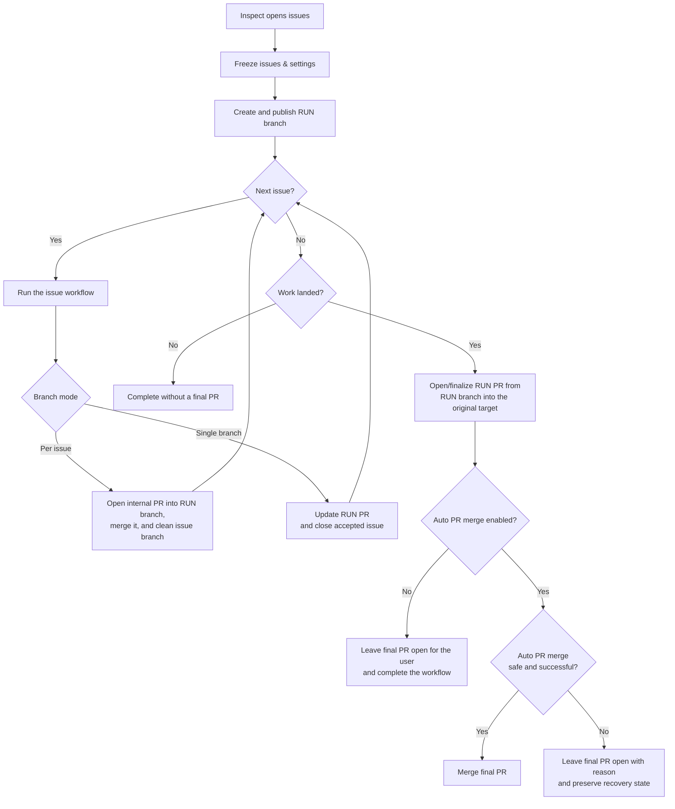
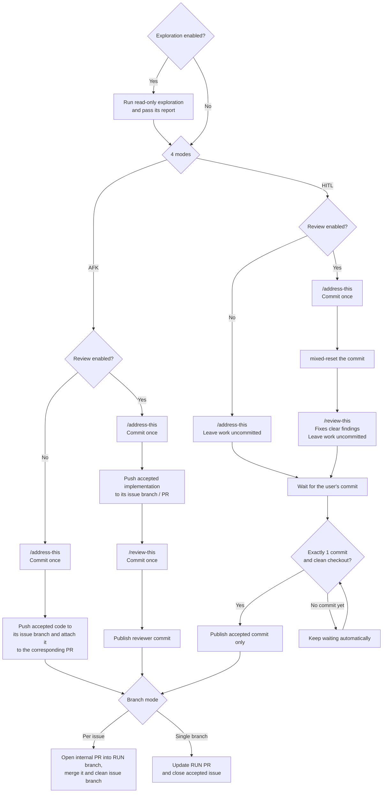

# Aboard

Aboard is a VS Code extension for visible Claude Code and ChatGPT sessions. It keeps agent work in terminals the user can inspect, gives the user one place to track active and recent sessions, and runs issue-driven AUTO RUN workflows without hiding the work from the user.

Install it through the [Harness catalogue](../../README.md#installation) by selecting `aboard`. Harness verifies the VSIX and installs the worker assets Aboard needs.

## At a glance

Aboard launches Claude Code or ChatGPT through visible VS Code terminals. Its Fleet shows live sessions,
Recent Activity records useful completed work, and AUTO RUN coordinates the local Git checkout with GitHub
issues and pull requests. An authenticated loopback bridge carries lifecycle events back to the extension.

## Visible sessions

Initialize the project once, then use **Run Agent** to choose Claude or ChatGPT and open an empty, attended
terminal. Each provider's command, model, and reasoning effort come from `.harness/launch.json`. Aboard reads
that file for every new launch, resume, or reopen, so existing processes keep their configuration while
future sessions use your latest choices.

The Fleet shows live sessions. Recent Activity keeps completed work available for inspection and supported reopen flows.

Focusing a live session reveals its existing terminal. Reopening an ended session asks that session's
recorded provider to resume the conversation with its latest launch configuration; if that conversation is
no longer available, its activity remains visible but cannot be reopened.

Interactive and manually delegated sessions inherit your native Claude Code or ChatGPT settings. Exploration sessions are read-only. AUTO RUN workers use stricter, extension-owned Git and GitHub restrictions.

## AUTO RUN

AUTO RUN turns labelled GitHub issues into a visible, recoverable queue. Review the forecast in the panel or run `/auto --dry`; start from the panel or run `/auto` when the plan looks right.

### Full Workflow



### Single Issue Workflow



- **HITL** publishes nothing until the user accept the final code by creating exactly 1 (non-empty) commit with a completely clean checkout. Aboard detects ordinary acceptance automatically.
- **AFK** accepts only a successful worker result with exactly 1 clean descendant commit.
- **Review** is mode-specific: an AFK reviewer contributes one fix or empty approval commit after publication; a HITL reviewer examines the uncommitted pinned code and leaves its fixes uncommitted for the user.
- Aboard owns branch changes, publication, integration, and GitHub mutations. Workers may inspect, edit, stage, and commit within their assigned checkout.

While HITL waits, focus the named implementer or reviewer handoff to inspect, continue, or ask that same
conversation to create the acceptance commit. Stopping preserves recoverable state and the exact failed worker
conversation. Resume is for stopped or interrupted attempts; a normal acceptance commit advances without it.
Discard follows the configured cleanup policy and never removes dirty or moved work it can no longer prove it owns.

## Configuration

| Location | Purpose |
| --- | --- |
| `.harness/launch.json` | Configures Claude and ChatGPT equally; `autoRun.provider` selects the Auto Run default. |
| `.abd/settings.json` | Stores project-level Aboard settings. |
| VS Code settings | Supplies user and profile defaults under `aboard.*`. |

Non-launch settings resolve from VS Code workspace settings, then `.abd/settings.json`, then user or profile settings and defaults. AUTO RUN freezes RUN-specific settings for recovery; it reads launch configuration again whenever it starts or resumes an agent.

The scaffold configures both providers. Claude is only the default for AUTO RUN; **Run Agent** asks for a
provider explicitly, and reopening follows the provider stored with the session:

```json
{
  "version": 3,
  "autoRun": { "provider": "claude" },
  "providers": {
    "claude": { "command": ["claude"] },
    "chatgpt": { "command": ["codex"] }
  }
}
```

Worktree mode gives a run its own checkout. Aboard copies ignored local `.claude`, `.agents`, `.codex`, and `.abd` configuration without overwriting tracked files. Optional setup commands live in `.abd/session-setup.ps1` and `.abd/session-setup.sh`.

## Development

From `apps/aboard/`:

```powershell
npm ci
npm run check
npm test
npm run test:vscode
npm run package
```

Use `npm run test:integration` for unit and VS Code integration tests. `npm run e2e:full` runs the complete disposable real-CLI journey.

Aboard keeps its npm build and `aboard-v<version>` release history independent from the Python installer. The packaged VSIX includes this README and the extension runtime, never the Harness skill catalogue.
