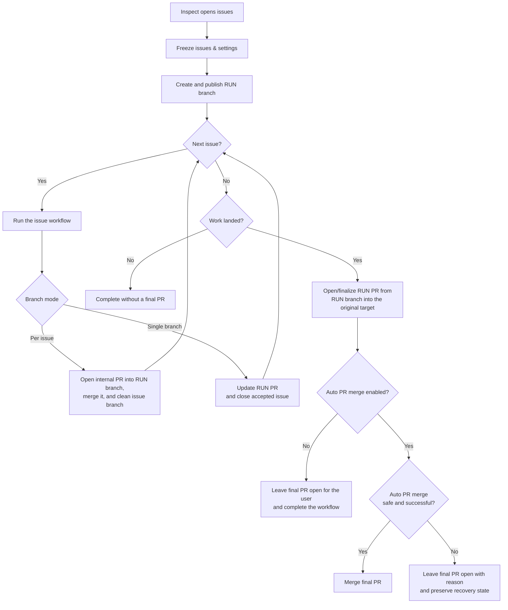
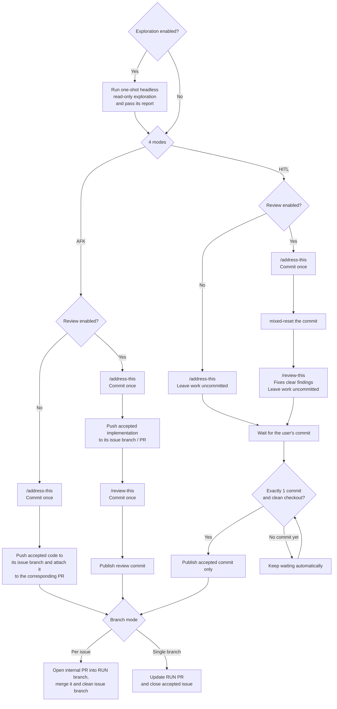

# Aboard

Aboard is a VS Code extension for Claude Code and ChatGPT conversations. It opens interactive work and AUTO RUN workers in visible terminals, and one-shot work you never take over — automatic delegations and AUTO RUN's read-only exploration — in background processes, with fleet and activity tracking for both.

Install it through the [Harness catalogue](../../README.md#installation) by selecting `aboard`. Harness verifies the VSIX and installs the worker assets Aboard needs.

## At a glance

Aboard launches interactive Claude Code or ChatGPT sessions through visible VS Code terminals. One-shot
work uses detached processes with structured output and execution logs. Its Fleet shows live sessions,
Recent Activity records useful completed work, and AUTO RUN coordinates the local Git checkout with GitHub
issues and pull requests. An authenticated loopback bridge carries lifecycle events back to the extension.

Click a background agent in **Agent Fleet**, or run **Aboard: Watch Background Agent** from the Command Palette, to open its live read-only progress channel. It shows observed provider steps, elapsed time, and the time since the last event. Harness-backed children can also be followed with `harness watch` from another terminal, with or without Aboard.

## Visible sessions

Initialize the project once, then open **Run Agent** above the Fleet. **Run Agent** adds one Claude Code or
Codex session as an editor terminal in the current window's active editor group, preserving its layout.
**Launch layout** starts the agents in the selected preset. Choose **New window** to open the same project
files in a new window and apply the preset grid once. Choose **Current window** to apply the grid in the
current window and start terminals in their assigned panes, keeping existing editors and terminals open.
The default preset has two vertically stacked
Codex terminals. A visible subagent opens as a new tab in its parent agent's editor group, even when you are
working in another pane.

Presets describe an initial grid using **Columns** and **Rows**, with up to nine panes. Each pane contains
terminal tabs. Select a pane to edit its providers; **Empty** opens a regular terminal using your default shell.
The preset field combines a dropdown with an editable name. **Save** updates the selected preset's name,
grid, and assignments. **Create** creates a new preset with the edited name and configuration, and is
enabled when the name differs from the selected preset. **Reset** restores its saved name, grid, and assignments.
Presets and your preferred selection are stored in extension user/profile storage.

The preset grid is applied once per explicit launch. Afterward, resizing, moving tabs, and merging groups
are under your control. Use **Run Agent** to add individual agents while keeping that arrangement, or
**Launch layout** with **Current window** to explicitly launch another preset grid and terminal batch.
Each window manages its own Fleet.

Launching agents disables automatic terminal group locking in the current workspace settings, so
new terminal panes can also open files. Groups you lock manually keep their locked state.

Closing a workspace during startup releases the launch controls; a window that never activates expires
after 15 seconds. Abandoned startup requests do not launch agents if the window opens later. A failed or
partially successful batch reports one error and keeps any running agents.

Workspace launch shows progress immediately. The new window displays a startup spinner and reports how
many agents are ready. Preset terminals open without waiting for earlier agents to finish starting.

The **Run Claude Code** and **Run Codex** commands remain direct shortcuts through the same launcher.
Each provider's command, model, and reasoning effort come from `.harness/config.json`. Aboard reads
that file whenever a launch, resume, or reopen starts a new process, so existing processes keep their
configuration while future sessions use your latest choices.

The Fleet shows live sessions. Recent Activity keeps completed work available for inspection and supported reopen flows.

Focusing a live interactive session reveals its existing terminal. Background sessions have no terminal.
Reopening an ended session preserves its provider, working directory, and conversation, and opens an
interactive terminal ready for you to type. If that conversation is
no longer available, its activity remains visible but cannot be reopened.

Interactive sessions and manual delegation tasks have independent launch profiles. Their omitted model and
effort settings inherit your native Claude Code or ChatGPT configuration, except exploration, which defaults
to Haiku/low for Claude and GPT-5.6 Luna/low for ChatGPT. Exploration sessions are read-only, run headlessly,
and cannot be stopped, taken over, or resumed. AUTO RUN workers use separate profiles and stricter,
extension-owned Git and GitHub restrictions.

## AUTO RUN

AUTO RUN turns labelled GitHub issues into a recoverable queue of unattended workers, each in its own
visible terminal. Review the forecast in the panel or run `/auto --dry`; start from the panel or run `/auto` when the plan looks right.

### Full Workflow



### Single Issue Workflow



- **HITL** publishes nothing until the user accept the final code by creating exactly 1 (non-empty) commit with a completely clean checkout. Aboard detects ordinary acceptance automatically.
- **AFK** accepts only a successful worker result with exactly 1 clean descendant commit.
- **Review** is mode-specific: an AFK review contributes one fix or empty approval commit after publication; a HITL review examines the uncommitted pinned code and leaves its fixes uncommitted for the user.
- Aboard owns branch changes, publication, integration, and GitHub mutations. Workers may inspect, edit, stage, and commit within their assigned checkout.

While HITL waits, inspect the worker's checkout and create the acceptance commit when the changes are ready.
The worker that handed off keeps its terminal, so you can also ask it for changes before you accept; closing
that terminal before the acceptance commit stops the run recoverably instead of waiting forever. Stopping preserves recoverable state and the exact failed worker
conversation. Resume is for stopped or interrupted attempts; a normal acceptance commit advances without it.
Discard follows the configured cleanup policy and never removes dirty or moved work it can no longer prove it owns.

## Configuration

| Location | Purpose |
| --- | --- |
| `.harness/config.json` | Configures Claude and ChatGPT equally; `autoRun.provider` selects the Auto Run default. |
| `.abd/settings.json` | Stores project-level Aboard settings. |
| VS Code settings | Supplies user and profile defaults under `aboard.*`. |

Non-launch settings resolve from VS Code workspace settings, then `.abd/settings.json`, then user or profile settings and defaults. AUTO RUN freezes RUN-specific settings for recovery; it reads launch configuration again whenever it starts or resumes an agent.

`aboard.sessions.interactiveResumeMode` controls interactive `resume-agent` continuations for Claude Code and ChatGPT. The default, `fork`, opens a new terminal with a copy of a live child's conversation. Set it to `reuse-terminal` to paste and submit the next message into the child's matching live terminal. Aboard focuses that terminal and preserves the conversation and reply tracking. If that session is no longer open or tracked, Aboard uses the existing fork/reopen flow. Reused processes retain their launch settings; auto execution is unaffected.

The scaffold is intentionally sparse. Omitted settings use product defaults, including Claude as the AUTO RUN provider and the native `claude` and `codex` commands:

```json
{
  "version": 1
}
```

Add only the overrides the project needs. Delegation profiles are independent from interactive sessions and AUTO RUN workers. Every profile can override its provider's `command`; omitted task commands inherit the provider command:

```json
{
  "version": 1,
  "providers": {
    "chatgpt": {
      "delegations": {
        "websearch": {
          "command": ["codex-wrapper", "search"],
          "model": "gpt-5.6-sol",
          "effort": "high"
        }
      }
    }
  }
}
```

For example, Claude Auto Run can explore through Kiro while its address and review workers keep using native Claude Code:

```json
{
  "version": 1,
  "providers": {
    "claude": {
      "command": ["claude"],
      "autoRun": {
        "explore": { "command": ["clauder", "run", "kiro"] }
      }
    }
  }
}
```

The available manual delegation keys are `explore`, `prototype`, `websearch`, `brainstorm`, `address`, `review`, and `general`. Prototype delegation supports only `interactive` mode; `auto` is rejected. AUTO RUN has separate `explore`, `address`, and `review` keys under each provider's `autoRun` object. The JSON schema supplies completion and documents key defaults; Aboard resolves the effective values in code.

Worktree mode gives a run its own checkout. Aboard copies ignored local `.claude`, `.agents`, `.codex`, and `.abd` configuration without overwriting tracked files. Optional setup commands live in `.abd/session-setup.ps1` and `.abd/session-setup.sh`.

The hosted Grill-Me board relay runs per project: it reads the board's `url` (an origin without a trailing slash) and shared four-digit `code` from the same sources as the grill hook: `.harness/config.local.json`, `.harness/config.json` (URL only), `~/.harness/config.json`, then the extension host's `HARNESS_GRILL_URL` and `HARNESS_GRILL_CODE`. The workspace must also be initialized, and a changed source takes effect after a window reload. A project without a ready `.abd/` neither reports presence nor polls the board, and removing `.abd/` stops its relay. Each relay reports its own project name and home-relative path alongside presence, so the board's Aboard status names the project it belongs to. Aboard reports only open, bound provider sessions, revalidates the terminal binding, submits the immutable prompt as ordinary bracketed-paste user input, and acknowledges the delivery only after the provider's `UserPromptSubmit` hook confirms it arrived; an unconfirmed prompt is reported as failed after 15 seconds. Aboard-launched terminals inherit both environment values.

## Development

From `apps/aboard/`:

```powershell
npm ci
npm run check
npm test
npm run test:vscode
npm run package
```

Use `npm run test:integration` for unit and VS Code integration tests. `npm run e2e:full` runs the complete disposable real-CLI journey.

Aboard keeps its npm build and `aboard-v<version>` release history independent from the Python installer. The packaged VSIX includes this README and the extension runtime, never the Harness skill catalogue.

Harness delegation uses persistent conversation inboxes outside the workspace. Children retain their Harness identities and execution modes across continuation. A caller-driven resume requires a next message. Live children normally continue in a fork; interactive children can instead receive the message in their existing terminal through `aboard.sessions.interactiveResumeMode`. Delegation request IDs are stored in extension runtime storage so restarting Aboard cannot blindly launch a request twice; conflicting reuse of an ID is refused.
