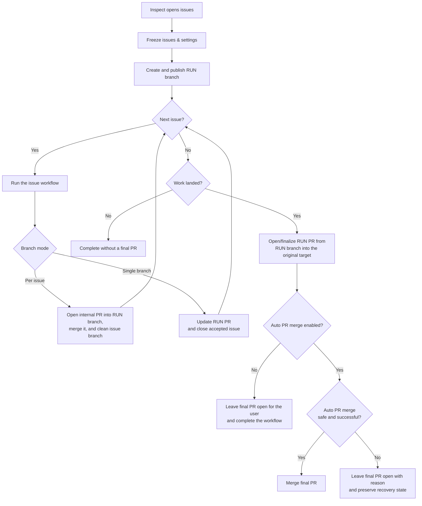
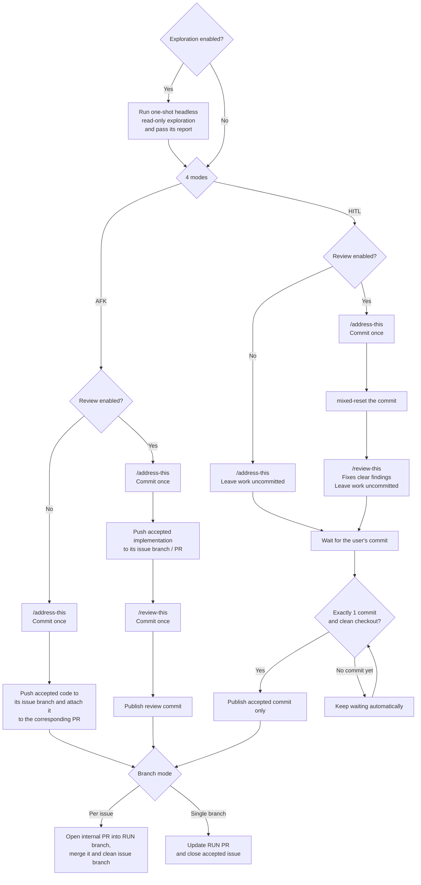

# Aboard

Aboard is a VS Code extension for Claude Code, ChatGPT, and Pi conversations. It opens interactive work and AUTO RUN workers in visible terminals, and one-shot work you never take over — automatic delegations and AUTO RUN's read-only exploration — in background processes, with fleet and activity tracking for both.

Install it through the [Harness catalogue](../../README.md#installation) by selecting `aboard`. Harness verifies the VSIX and installs the worker assets Aboard needs.

Pi support is shipped in the catalogue's Aboard 0.3.13 release for Pi 1.2.0. The source checkout's headless Pi integration was also revalidated against Pi 1.4.0 on Windows with the fake API on 2026-10-27. Select Pi in Run Agent, or set `autoRun.provider` to `"pi"` in `.harness/config.json`. Configure `providers.pi.interactive`, `delegations`, and `autoRun` independently with `command`, `model`, and `effort`. Models inherit Pi settings unless overridden; explicit models use native Pi model patterns, including extension-provided models. Exploration defaults to low thinking.

Pi workers invoke `/skill:address-this` and `/skill:review-this` from the installed Harness issue-readers skills. Ordinary sessions preserve native Pi resources. Exploration and Auto Run workers load only Aboard's extension and a fixed native tool set, disable MCP, and enforce restrictions on nested tool calls through the shared Python guard. Pi Auto Run supports worktrees: workers launch in the assigned checkout and receive that checkout guidance on every turn, including after resume or compaction. Pi relies on agents following this guidance rather than filesystem sandboxing. `/auto` is supplied by Harness's native Pi extension.

## At a glance

Aboard launches interactive Claude Code, ChatGPT, or Pi sessions through visible VS Code terminals. One-shot
work uses detached processes with structured output and execution logs. Its Fleet shows live sessions,
Recent Activity records useful completed work, and AUTO RUN coordinates the local Git checkout with GitHub
issues and pull requests. An authenticated loopback bridge carries lifecycle events back to the extension.

Click a background agent in **Agent Fleet**, or run **Aboard: Watch Background Agent** from the Command Palette, to open its live read-only progress channel. It shows observed provider steps, elapsed time, and the time since the last event. Harness-backed children can also be followed with `harness watch` from another terminal, with or without Aboard.

## Visible sessions

Initialize the project once, then open **Run Agent** above the Fleet. **Run Agent** adds one Claude Code or
Codex or Pi session as an editor terminal in the current window's active editor group, preserving its layout.
**Launch layout** starts the agents in the selected preset. Choose **New window** to open the selected checkout
in a new window and apply the preset grid once. These generated workspace duplicates are not added to
VS Code's **Open Recent** list. Choose **Current window** to apply the grid in the
current window and start terminals in their assigned panes, keeping existing editors and terminals open.
The default preset has two vertically stacked
Codex terminals. A visible subagent opens as a new tab in its parent agent's editor group, even when you are
working in another pane.

Presets describe an initial grid using **Columns** and **Rows**, with up to nine panes. Each pane contains
terminal tabs. Reducing Columns or Rows removes the extra panes from the draft preset, without closing running terminals. Select a pane to edit its providers; **Empty** opens a regular terminal using your default shell.
The preset field combines a dropdown with an editable name. **Save** updates the selected preset's name,
grid, and assignments. **Create** creates a new preset with the edited name and configuration, and is
enabled when the name differs from the selected preset. **Reset** restores its saved name, grid, and assignments.
Presets and your preferred selection are stored in extension user/profile storage.

The preset grid is applied once per explicit launch. Afterward, resizing, moving tabs, and merging groups
are under your control. Use **Run Agent** to add individual agents while keeping that arrangement, or
**Launch layout** with **Current window** to explicitly launch another preset grid and terminal batch.
Each window manages its own Fleet.

### Choosing a checkout

**Run Agent** asks for a provider, then offers **Current checkout**, **New worktree…**, and the repository's
other registered worktrees. The provider-specific commands skip only the provider question. Existing
worktrees show their branch and path; dirty checkouts can be used without resetting or replacing their files.

In **Run Agent**, choose **New worktree…** and enter a branch name. The default starting point is the current checkout's exact HEAD,
including local commits; uncommitted changes stay behind. Optionally choose another branch, remote-tracking
ref, or commit. No fetch or push is required. An existing local branch requires explicit reuse; a branch already
checked out elsewhere must be selected through its existing worktree instead.

**Launch layout** has separate **Window** and **Checkout** selectors. Choosing **New worktree…** reveals the
branch field below the path preview. Only new branch names are accepted, with inline validation; new branches
always start from the current checkout's HEAD. The selector shows `checkout-name (branch)`, while the path
summary marks modified checkouts. Paths displayed in the panel abbreviate your home directory as `~`.
Every agent and ordinary shell tab in that layout uses the selected checkout. Checkout choices are not saved in presets.

New worktrees use the first free numbered sibling of the repository's main checkout: `project-1`, `project-2`,
and so on, reusing available gaps. Launching from `project-2` still allocates a `project-N` sibling, never `project-2-1`.
The existing `aboard.autoRun.worktree.root` directory override and `setupTimeoutSeconds` limit also apply to
manual worktree creation; its `enabled` and `keep` settings do not control manual launches.

Creation runs the same optional `.abd/session-setup.ps1` / `.abd/session-setup.sh`
scripts as Auto Run. Aboard does not copy local project configuration or require it to be ignored by Git;
the setup script controls any preparation the user wants. The script comes from the source checkout and runs with the new checkout as its working
directory, once per worktree rather than per terminal. Existing checkout selection never reruns setup or copies
configuration. If the setup script fails, Aboard reports the error, retains the checkout, and offers
**Use existing worktree**, **Open checkout**, and **View log**. Existing/current checkout launches do not
require setup success, consult historical setup records, or rerun setup.

A new window opens the selected checkout as its project folder without installing or updating scaffold files.
Project scaffolding is explicit and optional; its absence or revision does not block launches or terminate
running sessions. In the current window, only terminal working
directories change: Explorer remains on the original folder. Launch layout and Run Agent show a short yellow warning without
an additional confirmation.
Fleet rows and terminal titles identify checkout directories; a Fleet or reopenable Recent Activity row offers **Open Checkout in New Window**. Activity and reopen retain the original checkout,
and manual launch, delegation, and reopen configuration is read from that checkout's `.harness/config.json`.
Missing checkouts are not silently replaced with the original project.

Manual worktrees are retained when agents exit, windows close, or startup fails. Remove them explicitly with
Git when finished. Worktrees isolate files, not agent permissions: ordinary interactive sessions retain native
provider permissions rather than acquiring Auto Run's restrictions. Known active Auto Run checkouts in this
window cannot be reused for manual launches. Run Agent's checkout picker shows agent counts from this window's
Fleet; the layout panel omits them. Other windows or external agents may also be using the checkout.

Launching agents disables automatic terminal group locking in the current workspace settings, so
new terminal panes can also open files. Groups you lock manually keep their locked state.
It also sets `workbench.editor.tabSizing` to `fixed`, using VS Code's native maximum tab width
(`workbench.editor.tabSizingFixedMaxWidth`, 160 px by default). This bounds long Pi, Claude Code,
and Codex titles visually without cutting the stored title. VS Code applies this sizing to all editor
tabs in the workspace; your configured minimum and maximum widths are preserved.

Closing a workspace during startup releases the launch controls; a window that never activates expires
after 15 seconds. Abandoned startup requests do not launch agents if the window opens later. A failed or
partially successful batch reports one error and keeps any running agents.

Workspace launch shows progress immediately. The new window displays a startup spinner and reports how
many agents are ready. Preset terminals open without waiting for earlier agents to finish starting.

The **Run Claude Code**, **Run Codex**, and **Run Pi** commands remain direct shortcuts through the same launcher.
Each provider's command, model, and reasoning effort come from `.harness/config.json`. Aboard reads
that file whenever a launch, resume, or reopen starts a new process, so existing processes keep their
configuration while future sessions use your latest choices. User-facing Reopen retains the provider's
saved model and effort instead of applying the current launch profile's model and effort.

The Fleet shows live sessions. Recent Activity keeps completed work available for inspection and supported reopen flows.

Focusing a live interactive session reveals its existing terminal. Background sessions have no terminal.
**Reopen Session** combines Aboard's tracked conversations with native Claude Code, Codex, and Pi
history, including sessions started outside Aboard. The picker opens immediately and adds rows as
provider metadata arrives; a loading indicator remains until discovery finishes. Each opening reads
native history again, without a persistent Aboard history index. Claude uses bounded head/tail reads,
Pi streams each distinct storage directory once with bounded concurrency, and Codex uses paginated
indexed metadata over a reusable app-server connection. Full conversation inspection runs only after
selection (live Aboard sessions may also be checked to omit empty terminals). Closing the picker
cancels pending discovery. When
Git is available, discovery includes the main checkout and all existing registered worktrees of the
repository, even when this window opens a linked worktree. Without Git, discovery uses the current
project folder. Unrelated projects are excluded; a missing worktree is not recreated.

Picker rows show the conversation title, provider, checkout folder, full checkout path, and last
activity. They distinguish an open Aboard terminal (focus), Aboard history (resume), and native history
(resume, but it may still be open outside Aboard). Native history is not evidence that the original
process has stopped; close any other instance before continuing the same conversation. Provider
history failures are reported in **Output → aboard** without hiding other providers' sessions.

Reopening preserves the provider, working directory, and conversation, and opens an interactive
terminal ready for you to type. An untracked native conversation receives a new Aboard identity and
an interactive launch profile; Aboard does not reconstruct Auto Run ownership or original permissions
from its transcript. Paste a session's full UUID into the Reopen picker to select it directly; UUIDs
are not displayed in its rows. If a recorded conversation is no longer available, its activity remains
visible but cannot be reopened. Clearing Recent Activity removes Aboard's records, not native history,
so discoverable conversations can still appear in Reopen.

Interactive sessions and manual subagents have separate launch profiles and inherit native model and
effort defaults. New manual subagents use the general delegation profile with an optional explicit skill.
AUTO RUN keeps its own exploration and worker profiles, including read-only headless exploration and
extension-owned Git/GitHub restrictions.

## AUTO RUN

AUTO RUN turns labelled GitHub issues into a recoverable queue of unattended workers, each in its own
visible terminal. Review the forecast in the panel or run `/auto --dry`; start from the panel or run `/auto` when the plan looks right.

### Full Workflow



### Single Issue Workflow



- **HITL** publishes nothing until the user accept the final code by creating exactly 1 (non-empty) commit with a completely clean checkout. Aboard detects ordinary acceptance automatically.
- **AFK** accepts only a successful worker result with exactly 1 clean descendant commit.
- **Review** is mode-specific: an AFK review contributes one fix or empty approval commit after publication; a HITL review examines the uncommitted pinned code and leaves its fixes uncommitted for the user.
- Aboard owns branch changes, publication, integration, and GitHub mutations. Workers may inspect, edit, stage, and commit within their assigned checkout.

While HITL waits, inspect the worker's checkout and create the acceptance commit when the changes are ready.
The worker that handed off keeps its terminal, so you can also ask it for changes before you accept; closing
that terminal before the acceptance commit stops the run recoverably instead of waiting forever. Stopping preserves recoverable state and the exact failed worker
conversation. Resume is for stopped or interrupted attempts; a normal acceptance commit advances without it.
Discard follows the configured cleanup policy and never removes dirty or moved work it can no longer prove it owns.

## Configuration

| Location | Purpose |
| --- | --- |
| `.harness/config.json` | Configures Claude and ChatGPT equally; `autoRun.provider` selects the Auto Run default. |
| `.abd/settings.json` | Stores project-level Aboard settings. |
| VS Code settings | Supplies user and profile defaults under `aboard.*`. |

Non-launch settings resolve from VS Code workspace settings, then `.abd/settings.json`, then user or profile settings and defaults. AUTO RUN freezes RUN-specific settings for recovery; it reads launch configuration again whenever it starts or resumes an agent.

`aboard.sessions.interactiveResumeMode` controls interactive subagent continuations for Claude Code and ChatGPT. The default, `fork`, opens a new terminal with a copy of a live child's conversation. Set it to `reuse-terminal` to paste and submit the next message into the child's matching live terminal. Aboard focuses that terminal and preserves the conversation and reply tracking. If that session is no longer open or tracked, Aboard uses the existing fork/reopen flow. Reused processes retain their launch settings; auto execution is unaffected.

The scaffold is intentionally sparse. Omitted settings use product defaults, including Claude as the AUTO RUN provider and the native `claude` and `codex` commands:

```json
{
  "version": 1
}
```

Add only the overrides the project needs. Delegation profiles are independent from interactive sessions and AUTO RUN workers. Every profile can override its provider's `command`; omitted profile commands inherit the provider command:

```json
{
  "version": 1,
  "providers": {
    "chatgpt": {
      "delegations": {
        "general": {
          "command": ["codex-wrapper", "search"],
          "model": "gpt-5.6-sol",
          "effort": "high"
        }
      }
    }
  }
}
```

For example, Claude Auto Run can explore through Kiro while its address and review workers keep using native Claude Code:

```json
{
  "version": 1,
  "providers": {
    "claude": {
      "command": ["claude"],
      "autoRun": {
        "explore": { "command": ["clauder", "run", "kiro"] }
      }
    }
  }
}
```

Claude profiles accept full model IDs such as `claude-opus-5-5`, alongside the native `haiku`, `sonnet`, and `opus` aliases. Full IDs select a specific model version; aliases follow Claude Code's native resolution. This requires Aboard 0.3.14 or later.

Manual subagents use `delegations.general` regardless of their optional explicit `skill`. Both `auto` and `interactive` modes accept any skill; a missing skill fails before launch. Older named profiles are not selected by new Harness requests. AUTO RUN has separate `explore`, `address`, and `review` keys under each provider's `autoRun` object. The JSON schema supplies completion and documents key defaults; Aboard resolves the effective values in code.

Worktree mode gives a run its own checkout. Aboard runs the user's optional setup script from `.abd/session-setup.ps1` or `.abd/session-setup.sh` in the source checkout, with the new checkout as its working directory. The script owns project preparation, including any desired configuration copying; Aboard does not copy local configuration or impose ignore rules on it.

The hosted Grill-Me board relay runs per project and defaults to `https://grill-me-in-cloud.vercel.app`. Only the shared four-digit `code` is required; `url` is an optional override (an origin without a trailing slash). It reads these fields from the same sources as the grill hook: `.harness/config.local.json`, `.harness/config.json` (URL only), `~/.harness/config.json`, then the extension host's `HARNESS_GRILL_URL` and `HARNESS_GRILL_CODE`. The workspace must also be initialized, and a changed source takes effect after a window reload. A project without a ready `.abd/` neither reports presence nor polls the board, and removing `.abd/` stops its relay. Each relay reports its own project name and home-relative path alongside presence, so the board's Aboard status names the project it belongs to. Aboard reports only open, bound provider sessions and revalidates the terminal binding before delivery. It submits exactly the reviewed website prompt for Claude Code, Codex, and Pi, preserving the answer text without a delivery header, file reference, or added instructions. Delivery is acknowledged only after the provider's `UserPromptSubmit` hook confirms the prompt arrived; an unconfirmed prompt is reported as failed after 15 seconds. Confirmation means the prompt was submitted, not that the agent has applied the answers. Aboard-launched terminals inherit both environment values.

## Development

From `apps/aboard/`:

```powershell
npm ci
npm run check
npm test
npm run test:vscode
npm run package
```

Use `npm run test:integration` for unit and VS Code integration tests. `npm run e2e:full` runs the complete disposable real-CLI journey.

Aboard keeps its npm build and `aboard-v<version>` release history independent from the Python installer. The packaged VSIX includes this README and the extension runtime, never the Harness skill catalogue.

Harness delegation uses persistent conversation inboxes outside the workspace. Children retain their Harness identities and execution modes across continuation. A caller-driven resume requires a next message. Live children normally continue in a fork; interactive children can instead receive the message in their existing terminal through `aboard.sessions.interactiveResumeMode`. Delegation request IDs are stored in extension runtime storage so restarting Aboard cannot blindly launch a request twice; conflicting reuse of an ID is refused.

Delegation launch and resume prompts preserve skill invocations. Native CLI commands such as `/resume` and `/compact` lose their slash prefix before delivery, including requests sent directly to Aboard's bridge. Harness and Aboard share the provider command lists and matching rules; the explicitly requested skill is added separately.

Grill delivery downloads edited diagram images from the configured authenticated board into an external runtime cache before submitting answers to the exact provider session. SHA256, size and PNG validation protect immutable retries. If preparation fails, the prompt retains its reviewed image IDs. For copy/paste, native Pi delivery, or an Aboard download failure, the Grill skill supplies a bundled `scripts/download_grill_image.py` helper that accepts an image ID and resolves Harness configuration internally.
