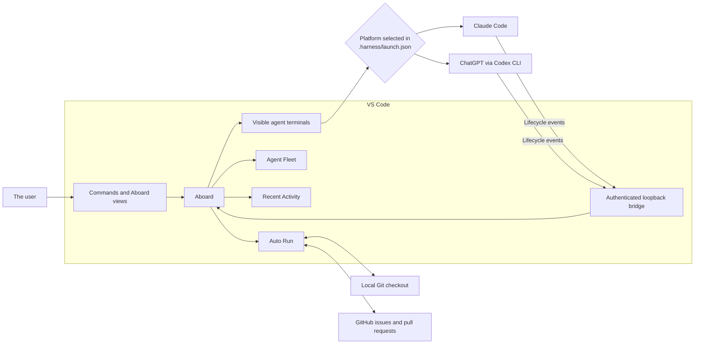
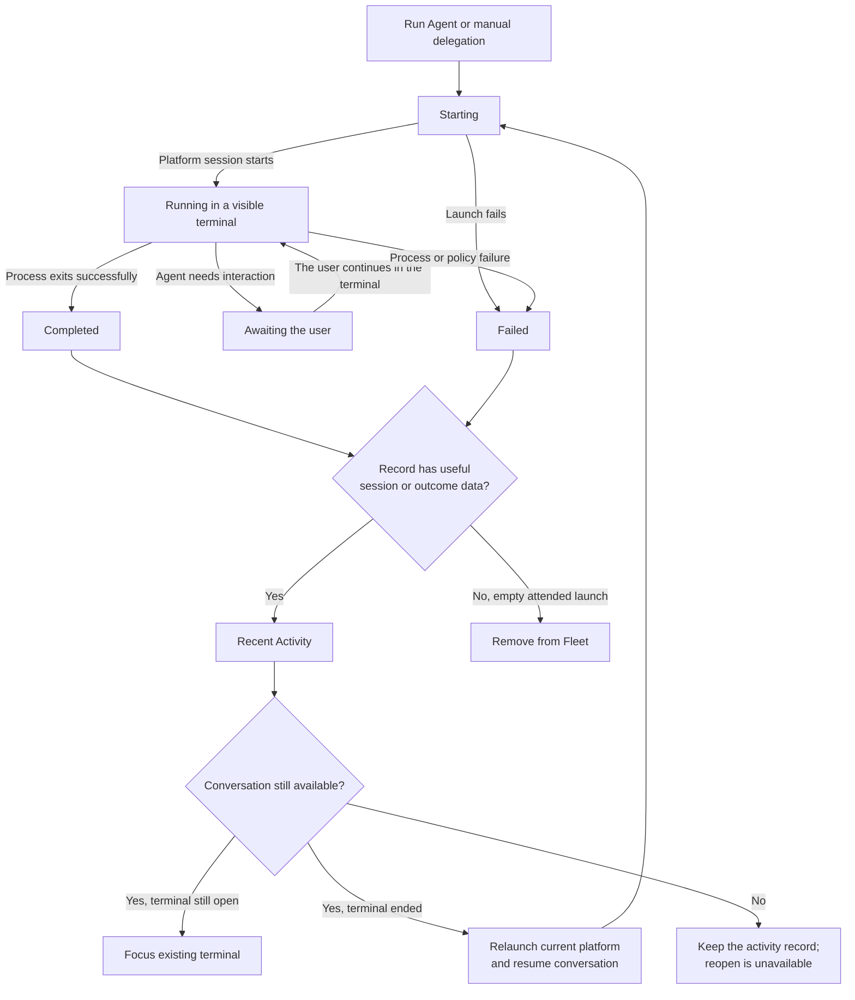
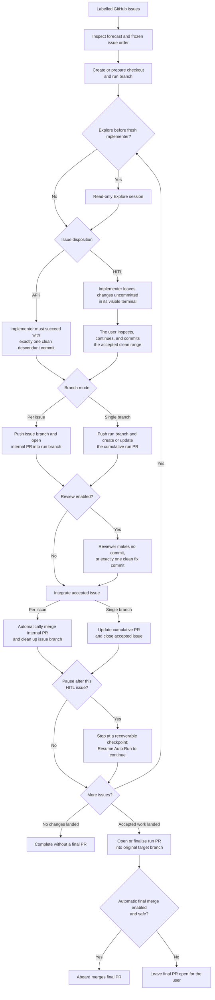

# Aboard

Aboard is a VS Code extension for visible Claude Code and ChatGPT sessions. It keeps agent work in terminals the user can inspect, gives the user one place to track active and recent sessions, and runs issue-driven Auto Run workflows without hiding the work from the user.

Install it through the [Harness catalogue](../../README.md#installation) by selecting `aboard`. Harness verifies the VSIX and installs the worker assets Aboard needs.

## At a glance



## Visible sessions

Initialize the project once, then use **Run Agent** to open an empty, attended terminal. The platform, model, and reasoning effort come from `.harness/launch.json`. Aboard reads that file for every new launch, resume, or reopen, so existing sessions keep their configuration while future sessions use the user's latest choices.

The Fleet shows live sessions. Recent Activity keeps completed work available for inspection and supported reopen flows.



Interactive and manually delegated sessions inherit the user's native Claude Code or ChatGPT settings. Explore sessions are read-only. Auto Run workers use stricter, extension-owned Git and GitHub restrictions.

## Auto Run

Auto Run turns labelled GitHub issues into a visible, recoverable queue. Review the forecast in the panel or run `/auto --dry`; start from the panel or run `/auto` when the plan looks right.



- **HITL** leaves implementation work in a visible terminal and waits for one or more clean commits that the user accepts.
- **AFK** accepts only a successful worker result with exactly one clean descendant commit.
- Aboard owns branch changes, publication, integration, and GitHub mutations. Workers may inspect, edit, stage, and commit within their assigned checkout.

Stopping preserves recoverable state. Resume continues from recorded checkpoints. Discard follows the configured cleanup policy and never removes dirty or moved work it can no longer prove it owns.

## Configuration

| Location | Purpose |
| --- | --- |
| `.harness/launch.json` | Selects Claude Code or ChatGPT, command, model, and reasoning effort. |
| `.abd/settings.json` | Stores project-level Aboard settings. |
| VS Code settings | Supplies user and profile defaults under `aboard.*`. |

Non-launch settings resolve from VS Code workspace settings, then `.abd/settings.json`, then user or profile settings and defaults. Auto Run freezes run-specific settings for recovery; it reads launch configuration again whenever it starts or resumes an agent.

Worktree mode gives a run its own checkout. Aboard copies ignored local `.claude`, `.agents`, `.codex`, and `.abd` configuration without overwriting tracked files. Optional setup commands live in `.abd/session-setup.ps1` and `.abd/session-setup.sh`.

## Development

From `apps/aboard/`:

```powershell
npm ci
npm run check
npm test
npm run test:vscode
npm run package
```

Use `npm run test:integration` for unit and VS Code integration tests. `npm run e2e:full` runs the complete disposable real-CLI journey.

Aboard keeps its npm build and `aboard-v<version>` release history independent from the Python installer. The packaged VSIX includes this README and the extension runtime, never the Harness skill catalogue.
