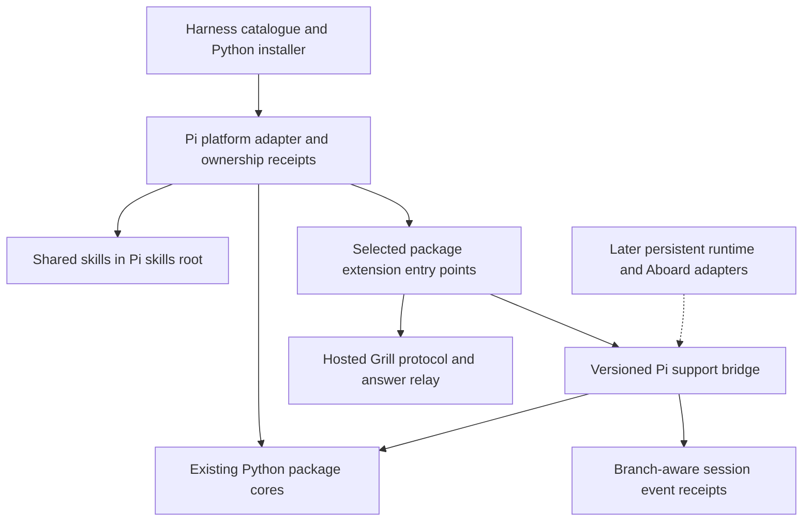

# Pi provider architecture proposal

Status: **24 shared skill packages, three path-guard extensions, the command guard, comment budgets, document draft approval, Git cleanup inventory, two issue workflow extensions, cloud interviews, session commits, desktop notifications and gotcha reports implemented; remaining extensions and runtime architecture proposed**.
Pi is an opt-in catalogue target for all 22 skill-led packages below, plus `caveman` and
`setup-help`. Shared skill installation
works at project and user scope; three path guards, the command guard, comment budgets, document draft approval, Git cleanup inventory,
both issue workflow packages, cloud interviews, session commits, desktop notifications and gotcha reports ship. The hosted Pi migration/app are deployed
and verified against the production board. Remaining extensions, persistent runtime, and Aboard are pending.
This proposal defines the implementation boundaries and first release scope.
The [compatibility report](PI-COMPATIBILITY.md) retains the catalogue-wide feasibility assessment.

The API basis is the [local official reference mirror](PI-REFERENCES/README.md), examined at upstream
revision `47fc5f38ec18d56fe64abd41a2dcf9e5170a3dcf` (`@earendil-works/pi-coding-agent` 1.2.0).
This is a design baseline, not runtime certification. Before implementation, verify the installed
Pi exports and CLI against that baseline and record the version used for acceptance checks.
Rolling reference refreshes do not widen the supported runtime range automatically.

The [Pi E2E implementation guide](../tests/e2e/README.md) describes the implemented JSON/RPC
fixture, which reuses the fake OpenAI Responses endpoint and isolated Pi configuration. It was
verified against installed Pi 1.2.0. The first tool journey installs the actual catalogue package,
runs its native skill in JSON/RPC, verifies a real passing test baseline and approved cleanup,
and checks receipt-driven removal. Inference is scripted; these checks certify integration,
not the quality of an unscripted model's audit judgments.

The shared-skill batch additionally checks native command discovery and explicit invocation
for all 23 skill entry points in its 22 packages, including `caveman` and `setup-help`, at
project and user scopes. The real Pi
parser verifies invocation policy; native tools read installed support files and write
fixture results, with exact inference counts and receipt-driven removal. These checks certify
resource integration, not unscripted workflow quality or external browser/GitHub services.

## First release scope

The following **35 packages** are the requested backlog, sorted by recommended implementation
priority. The original list defined scope, not priority. Complete the shared skill ports first,
then build the extension bridge through `command-guard` and port dependent integrations; commit
attribution and hosted grilling follow because they have the largest state/service requirements.
Within each group, favor core development workflows before optional ergonomics. Shared
prerequisites must land before their dependent packages.

"Lavish Prototype" maps to the existing `lavish` and `prototype` packages; "Git cleanup",
"next decisions", and "HITL TODOs" map to `cleanup-git`, `next-decision`, and `todo-hitl`.

**Skill** means reuse the shared instructions/scripts/CLI with Pi mappings and any required
portability edits. **Extension** means a native Pi entry point plus existing package cores;
it can also include shared skills. Rows marked implemented ship the stated Pi resources; unmarked rows remain planned.

| Priority | Package | Route | Completion requirement beyond installer support |
| --- | --- | --- | --- |
| 1 | `flush-out-useless-tests` | Skill | Implemented in 1.1.0. Project JSON/RPC and user RPC journeys verify installation, audit, approved cleanup, and removal. |
| 2 | `tdd` | Skill | Implemented. Behavior-focused red/green work and supporting references are installed. |
| 3 | `test-workflows` | Skill | Implemented. Existing CLI and shared skill; real acceptance execution, explicit confirmation and stale covered-file hashes verified through Pi. |
| 4 | `resolving-merge-conflicts` | Skill | Implemented. Preserve merge/rebase intent and project verification. |
| 5 | `setup-git-worktree-maker` | Skill | Implemented. Copy necessary project Pi resources while keeping personal credentials and sessions outside worktrees. |
| 6 | `audit` | Skill | Implemented. Pi runs the audit in one session; explicit explorer delegation waits for the later runtime adapter. |
| 7 | `grill-me` | Skill | Implemented. Preserve frontier questions and explicit user decisions. |
| 8 | `breakdown-help-wanted-issue` | Skill | Implemented. Preserve clarification and authenticated GitHub lookup. |
| 9 | `read-all-adrs` | Skill | Implemented. Read the full ADR inventory with honest context limits. |
| 10 | `writing-adrs` | Skill | Implemented. Preserve decision-document conventions and supporting references. |
| 11 | `writing-for-agents` | Skill | Implemented. Shared reference includes Pi invocation, discovery, and frontmatter mechanics. |
| 12 | `zoom-out` | Skill | Implemented. Reuse abstraction mapping and codebase navigation. |
| 13 | `prototype` | Skill | Implemented. Preserve throwaway branch and interactive-only workflow; verify UI with actually available tools. |
| 14 | `lavish` | Skill | Implemented. Make argument handling portable; retain the existing Lavish CLI and external review requirements. |
| 15 | `handoff` | Skill | Implemented. Preserve temporary output and secret redaction. |
| 16 | `handoff-grilling` | Skill | Implemented. Preserve design-tree handoff and temporary output. |
| 17 | `todo-hitl` | Skill | Implemented. Support both `mark-as-todo-hitl` and `address-todo-hitl`, retaining agreement before remediation. |
| 18 | `decisions` | Skill | Implemented. Reuse retrospective decision review over available conversation context. |
| 19 | `next-decision` | Skill | Implemented. Preserve recommendations and the wait for explicit decisions. |
| 20 | `stop-overthinking` | Skill | Implemented. Reuse the practical-decision workflow. |
| 21 | `setup-command-aliases` | Skill | Implemented. Preserve shell configuration and activation; document any Pi alias explicitly. |
| 22 | `setup-text-replacements` | Skill | Implemented. Preserve AutoHotkey edit/reload behavior and Windows-only scope. |
| 23 | `command-guard` | Extension | Implemented in 2.2.0. Native `tool_call` evaluates `bash` / `powershell` against the shared Python TOML/regex core; a matched command, malformed policy, or broken runtime denies the call fail-closed. |
| 24 | `on-read-reminder` | Extension | Implemented in 2.2.0. Successful native/shell reads remind; partial read ranges are recorded accurately. |
| 25 | `on-edit-reminder` | Extension | Implemented in 2.2.0. Successful native edits remind with the existing 120-second cooldown and branch-local read suppression. |
| 26 | `on-edit-block` | Extension | Implemented in 2.2.0. Native writes/edits require complete reads or fully delivered denial guidance on the active branch, including nested calls. |
| 27 | `prefer-fewer-comments` | Extension | Implemented in 2.3.0. Native queued before/after snapshots, shared lexer/budgets/exemptions, branch-local advisory cooldown; unchanged comment bodies are excluded. |
| 28 | `no-new-documents` | Extension | Implemented. Native creation guard, draft mirrors, branch-local notices and zero-inference approval/rejection with exclusive publication. |
| 29 | `issue-readers` | Extension | Implemented in 1.6.0. Prepare complete paginated `address-this` / `review-this` context through the issue graph before native skill expansion; preparation errors stop inference. |
| 30 | `issue-writers` | Extension | Implemented in 2.3.0. Supply native session draft paths for the four drafting/spec skills; intercept the fifth (`publish-issues`) through a native command with existing locks and ordering, without inference. |
| 31 | `cleanup-git` | Extension | Implemented. Inject the existing read-only inventory before native skill expansion; keep approval and live-state checks before cleanup. |
| 32 | `enable-desktop-notification` | Extension | Implemented in 1.1.0. Native zero-inference enable/disable, session-persistent opt-in and one final-settlement notification through the shared OS notifier. |
| 33 | `report-gotchas` | Extension | Implemented in 1.2.0. Native structured submission binds Pi identity before durable queue publication; session-wide deduplication, serialized workers and zero-inference retry reuse the shared Python runtime. |
| 34 | `commit` | Extension | Implemented in 1.7.0. Native zero-inference command, shared staging/Git/message generation and verified successful-write attribution on the active Pi session branch; uncertain ownership stops before staging. |
| 35 | `grill-me-in-cloud` | Extension | Implemented in 2.2.0. Shared publication/assets/outbox core, native round preparation and standalone persisted-message answer relay. Additive hosted contract/migration deployed; real Pi project/user journeys pass against local and production services. |

That is **22 skill-led packages and 13 extension-backed packages**. These are routes, not effort
estimates: commit and hosted grilling have substantially larger state/integration requirements.

`caveman` and `setup-help` additionally ship Pi support in 1.1.0, outside the original
35-package backlog. They install the unchanged shared skills at project and user scope;
native discovery and explicit invocation are verified by the shared-skill batch.

`redirect-subagents`, `prefer-read-tool`, and `prefer-edit-tool` are Claude-only tools.
`agent-launcher` is not required for Pi and is excluded from planned Pi ports.

The first release does not require `subagents`, `ship`, `aboard`, `auto`,
`mid-prompt-skills`, quota waiting, or archived packages. Keep those as future consumers of the
same provider boundaries. Tools requiring browser/search integrations must report missing
capabilities; choosing Pi or a model service does not supply those tools automatically.

## Architecture boundaries



The installer owns file placement, dependencies, reconciliation, and receipts. A Pi extension owns
native event/command translation. Existing package cores own policy parsing and deterministic
operations. Model-driven workflows remain shared skills. This keeps each catalogue selection
independent and avoids moving workflow behavior into an application dependency.

## Installer and package layout

The [platform adapters](../src/harness_cli/platforms.py) now provide `Platform.PI`, `PiAdapter`,
and centralized available/default provider sets consumed by both installer entry points.
The logical `extensions` destination is implemented for Pi at project and user scope.
Available platforms are separate from default targets: Pi is opt-in, and omitted
`--platform` retains the existing Claude/ChatGPT behavior. The interactive menu offers Pi
without adding it to an existing installation's selections automatically.

| Logical destination | Project installation | User installation |
| --- | --- | --- |
| `platform` | `<project>/.pi` | `<agent-dir>` |
| `skills` | `.pi/skills` | `<agent-dir>/skills` |
| `extensions` | `.pi/extensions` | `<agent-dir>/extensions` |
| `hooks` (Python/support files) | `.pi/hooks` | `<agent-dir>/hooks` |
| `workspace` (shared policies) | `<project>/.harness/...` | Existing user Harness configuration paths |

`<agent-dir>` defaults to `~/.pi/agent` and respects `PI_CODING_AGENT_DIR`, as documented in
[Configuration](PI-REFERENCES/docs/configuration.md). User Harness state retains its existing
`HARNESS_STATE_DIR` semantics; the Pi environment variable changes Pi resources only.

[`Target.destination_path`](../src/harness_cli/installer.py) now checks declared containment
boundaries before ancestor traversal. The Pi user scope root is its resolved agent directory,
so custom directories outside the home have distinct receipt identities. Changing
`PI_CODING_AGENT_DIR` selects another installation rather than redirecting removal of the original;
the first tool journey verifies that separation. A Pi user receipt also records a user-scope
namespace, keeping it separate from a project rooted in the same agent directory.
Claude/ChatGPT receipt identities are unchanged.

The table describes the intended full layout. The current slice supports skill and extension payloads without
configuration fragments. Pi user `workspace` payloads and configuration fragments explicitly
fail until shared-workspace ownership and native settings reconciliation are implemented;
the three path guards use hook-local user starters rather than user workspace mappings.

Source packages retain their root-level shared skill/core files and shallow `pi/` overlays:

```text
harness/<category>/<tool>/
├── harness.toml
├── SKILL.md or <skill>/SKILL.md
├── <tool>_hook.py and support modules
├── claude/ and chatgpt/ where needed
└── pi/
    └── extension.ts

Installed Pi resources:
.pi/skills/<skill>/SKILL.md
.pi/extensions/harness-<tool>/index.ts
.pi/hooks/<tool>_hook.py
.pi/hooks/pi-support/<bridge modules>
```

The file mappings install the entry point as `index.ts`; source overlays never appear inside
installed skills. Python helpers and bridge modules stay outside extension auto-discovery.
Map only each skill's shared files, excluding ChatGPT metadata. Prefer Pi-owned copies in
`.pi/skills`; Pi also discovers `.agents/skills`, so test native name collisions with ChatGPT
and Claude symlink installations. Use startup diagnostics to identify the selected skill source.
Do not silently disable the user's own shared skill discovery.

Use conventional resource directories for the first release; most packages need no Pi settings
fragment. Before adding fragments, move configuration addition/shared-removal accounting behind
the adapter: `installer.py` currently calls `settings_merge.additions` and `remove_shared`
directly. Pi settings resource filters and package objects need native identity semantics, not
Claude hook-array reconciliation. Preserve unrelated resource filters, models, tools, and settings.
Harness must not own Pi authentication, trust decisions, native sessions, or unrelated extensions.
[Pi Packages](PI-REFERENCES/docs/packages.md) remain an optional later distribution format;
Harness continues to own the files it installs rather than introducing a second installer owner.

Pi itself is an external prerequisite for this release. The current host-action schema supports
pinned Python tools and VSIXs; adding npm/CLI ownership would be a separate design change.

## Shared Pi support and Python reuse

The path guards ship a non-selectable `harness/extension/pi-support` package with versioned transport,
event normalization and branch receipt utilities for these three guards. Issue workflow input routing and native publication also ship; broader provider support remains proposed. Package cores own the TOML policies.
Each selected extension imports the installed support modules and registers its own behavior.
Skills without extension behavior do not depend on it.

The installer filters [manifest dependencies](../src/harness_cli/manifest.py) by their optional
platform list before catalogue resolution and receipt accounting. Extension packages declare a version-constrained, Pi-only, coupled
dependency on `pi-support`; existing dependencies without a filter retain their behavior.
Multiple Pi packages share one receipt-owned copy, removed when its last dependent is removed.
This avoids requiring the bridge for Claude/ChatGPT and avoids one bridge copy per package.

Start with bounded subprocess calls per relevant event. Choose Python through the installer's
existing interpreter resolution and record the launch argv; send requests as UTF-8 JSON on stdin,
parse one versioned JSON response, and keep diagnostics on stderr. Propagate cancellation,
timeouts, output limits, and exit/protocol errors. Never build shell commands from prompt text.
A persistent worker can follow measured latency evidence; it is not required for initial support.

Reuse Python parsing, regexes, shell detection, Git/GitHub logic, publishing, and notification
code. Extract callable core functions where a current hook mixes those operations with provider
I/O. Retain existing hook entry points for Claude/ChatGPT. Pi passes normalized operations into
the cores instead of fabricating Claude transcripts or emulating the entire hook protocol.

The proposed bridge request carries protocol version, operation, cwd, provider `pi`, session
ID/file, active branch anchor, tool-call/parent-call IDs where present, native tool name/input,
and observed outcome. Responses distinguish allow/block, model guidance, deterministic command
output, and diagnostics. Individual cores receive only the fields they need. Successful command
output does not imply a request to start a model turn.

## Event handling and state

The mapping below follows [Extensions](PI-REFERENCES/docs/extensions.md) and the exported
[API types](PI-REFERENCES/src/core/extensions/types.ts). It is the proposed Harness adapter
contract, with failure behavior exercised before a package is advertised as supported.

| Boundary | Pi API | Harness responsibility |
| --- | --- | --- |
| Bind/recover identity | `session_start` | Rebind on startup/reload/new/resume/fork; rebuild branch state. |
| Change active ancestry | `session_tree` | Rebuild permissions/attribution and invalidate stale pending context after tree navigation. |
| Prepare a workflow | `input` / `before_agent_start` | Supply context for the actual explicit invocation once. |
| Deterministic user command | `registerCommand` | Execute the core and display status with no agent inference turn. |
| Deny a model tool operation | `tool_call` | Normalize native schemas and block before execution. |
| Record outcome / append guidance | `tool_result` | Attribute observed changes; deliver informational guidance after success. |
| Persist branch-local metadata | `appendEntry` / session manager | Record receipts and reconstruct only the active ancestry. |
| Refresh compacted context | `session_compact` / next-run preparation | Restore required package context with deduplication. |
| Continue for actionable feedback, later | `agent_before_settle` | Require concrete new context and bounded continuation. |
| Notify final completion | `agent_settled` | Notify once; do not mistake `agent_end` for final completion. |
| Release resources | `session_shutdown` | Abort pending transport and release timers/listeners idempotently. |

Factories register behavior only. Start session resources at session start or on demand and
dispose them on shutdown. Preserve original tool content, details, usage, and error status;
when returning replaced `content`, explicitly preserve `structuredContent` for additive guidance.
Read/edit reminders must not convert a successful operation into an error.

Session JSONL is a tree ([Session format](PI-REFERENCES/docs/session-format.md)). Identity is
the provider plus native session ID and exact saved file, with an active branch anchor for
state reconstruction. Terminal PID is execution identity only. Successful-read receipts include
the delivered range and guidance identity; an attempted or partial read never proves a complete
guide was read. Keep current package-specific delivery/cooldown behavior explicit.

Record events directly, including nested tool calls. Pi's nested execution passes through tool
events but does not create transcript tool entries; its bounded `nestedCalls` summary can omit
arguments. It is insufficient as the sole source for commit attribution or read permissions.
Persist minimal branch-linked receipts for successful reads/writes and command consumption,
with call IDs for deduplication. After reload, recover from receipts on the active ancestry;
abandoned branches do not authorize edits or contribute a previous-message selection.

Commit additionally needs a conservative attribution ledger: observed successful file changes,
per-call pre/post evidence where needed, and already committed changes. Account for recognized
shell writes, failed commands with partial mutations, parallel calls, nested calls, prior commits,
and external changes. A successful shell exit alone does not identify all files it changed.
Preserve existing-index protection; incomplete attribution must stop the automated commit and
report the uncertainty for user resolution, never stage every dirty file. Branch changes do not
rewind the working tree, so verify current file/index evidence against branch receipts.

## Commands and explicit skill invocation

Shared workflows use Pi's native `/skill:name arguments`. Pi appends arguments to the request;
Claude substitutions such as `$ARGUMENTS`, fork semantics, and tool permissions need explicit
portability treatment. Preserve `disable-model-invocation: true` for user-only skills.
`enableSkillCommands` controls interactive discovery, not whether a manually entered command
can execute ([Skills](PI-REFERENCES/docs/skills.md)).

Register native `/commit`, `/publish-issues`, `/approve-doc-draft`, `/reject-doc-draft`, and
`/enable-desktop-notification` handlers. Keep existing options and error behavior. These commands
create no Pi agent inference request; `/commit --ai` may still call its existing explicitly
requested message-generation service. Measure those requests separately.

Short extension commands dispatch before the ordinary `input` handler. Handle both `/name` and
`/skill:name` for deterministic commands so direct skill invocation cannot load an interception
failure body or start an accidental agent turn. For prepared workflows such as issue readers,
cleanup, and cloud grilling, choose and test one routing path per invocation: resolve the shared
skill, prepare package context, then submit once. Extension-sent messages only expand commands
when `expandPromptTemplates` is requested; avoid recursive alias expansion. Test typed input,
RPC input, extension submission, missing arguments, and errors independently.

Explicit invocation remains the source of workflow authorization. Installation supplies tools
and guards; it does not start issue publication, Git cleanup, or an interview automatically.

## Hosted grilling without an Aboard dependency

`grill-me-in-cloud` is in the requested release, while the full Pi Aboard adapter is deferred.
Propose a session-scoped relay owned by the grilling extension, reusing existing hosted delivery
contracts. It polls/claims queued answers, submits them through Pi's native user-message API,
and acknowledges only after a correlated, persisted user-message receipt confirms acceptance by
the bound session. The void return from `sendUserMessage` alone is insufficient confirmation.
It needs no Harness ask/reply runtime and keeps the real Pi TUI visible.

The relay and a later Aboard relay must compete through the same delivery claim/idempotency
rules, so both running cannot double-submit an answer. Persist delivery IDs and submission receipts
before retrying; recover an accepted-but-unacknowledged submission without resending it. Rebind on
session replacement, invalidate stale round context after branch navigation, cancel polling on
shutdown, and preserve queued answers on disconnect, failed submission, or loss of ownership.
Keep current configuration/credentials outside model-facing context.

This requires additive `pi` support in [`protocol/grill/v1/states.json`](../protocol/grill/v1/states.json),
hosted schemas/API validation, Pi session/title extraction, and a **new** database migration
widening existing provider constraints. Do not rewrite the initial migration. A publication-only
port is incomplete: round publication, assets, presence, queued answers, and confirmed delivery
must pass together. Development and migration preparation precede any separately authorized
deployment; an older hosted service needs an explicit unsupported-provider error.

## Guard coverage and admission

### Shipped comment-budget implementation

`prefer-fewer-comments` 2.3.0 uses **native tool definitions with injected filesystem
operations**, rather than `tool_call`/`tool_result` disk snapshots. Research covered the
mirrored [extension contract](PI-REFERENCES/docs/extensions.md#custom-tools),
[override example](PI-REFERENCES/examples/extensions/tool-override.ts),
[event types](PI-REFERENCES/src/core/extensions/types.ts), and the installed Pi 1.2.0
public exports, write/edit implementations, argument preparation, and mutation queue.
The pinned source evidence is upstream's
[write definition](https://github.com/earendil-works/pi/blob/47fc5f38ec18d56fe64abd41a2dcf9e5170a3dcf/packages/coding-agent/src/core/tools/write.ts),
[edit definition](https://github.com/earendil-works/pi/blob/47fc5f38ec18d56fe64abd41a2dcf9e5170a3dcf/packages/coding-agent/src/core/tools/edit.ts), and
[file queue](https://github.com/earendil-works/pi/blob/47fc5f38ec18d56fe64abd41a2dcf9e5170a3dcf/packages/coding-agent/src/core/tools/file-mutation-queue.ts).
Those sources were cross-checked against the installed 1.2.0 runtime before implementation.

The decision preserves the package's forward-looking preference. Pre-execution blocking
would reject useful comments before the existing functional-benefit exception could be
applied. Automatic removal or corrective continuation would alter existing code and spend
additional inference without user intent. Advisory guidance belongs on the successful tool
result; it neither rewrites comments nor triggers an extra model turn.

Event snapshots lose mutation attribution: sibling calls can capture the same stale before
state outside Pi's queue, and a result callback can read a later sibling's write. Git diffs
also include pre-session/user changes, miss untracked files without extra machinery, and
require a repository. Native operation injection captures each queued mutation directly,
including non-Git projects, without copying Pi's private path/edit algorithms or replacing
the existing lexer in TypeScript.

The extension spreads `createWriteToolDefinition` / `createEditToolDefinition` and replaces
only execution. Every execution creates fresh operations closures. Native edit supplies
the old buffer and the final string after matching, BOM and line-ending handling; native write
reads its old contents immediately before its queued write. Missing files have an empty
before snapshot; unreadable/unbounded snapshots do not obstruct a native write. Guidance
uses captured strings after native success, never a result-time reread. The full native
operation retains Pi's own queue; acquiring the same queue around delegation would deadlock.
Native schema preparation, multi-edit/fuzzy matching, path normalization, prompt guidelines,
renderers, diffs and other tool guards remain native. Nested `ctx.executeTool` dispatch still
passes through their regular events.

The Python adapter reuses policy precedence, language scanning, budgets, exemptions and
message construction. With the old snapshot supplied, scanning excludes unchanged comment
bodies by multiplicity before grouping new adjacent line comments. This avoids flagging a
large old inline comment when only neighboring code changed, or charging an old line-comment
block to one short addition. Changed block comments/docstrings retain whole-comment budgets;
density charges only added lines. Multiline backticks remain string context; inline comments
retain the code line that ends the file-header region. The lexer is
heuristic rather than a language parser; unsupported file families are skipped.

Feedback is serialized separately from mutations, so parallel successes cannot both spend
the same cooldown or first-reminder slot. Durable `harness-prefer-fewer-comments-v1` entries
contain call ID, interpreter argv and canonical file path/time receipts only. Absolute file
identity separates same-named files outside the project and shares cooldown through path aliases.
They are reconstructed from
`getBranch()`, including nested calls, instead of external process-global markers. Reload
and exact resume retain cooldown; navigating before delivery discards that branch's authority.
Session/tree/shutdown events cancel stale helper work. Failed/cancelled native calls consume
no reminder, and analysis failures retain success with an additive diagnostic. Snapshots are
bounded at 512 KiB each; the shared versioned subprocess transport adds timeout, cancellation
and request/output bounds. There are no persistent workers, filesystem snapshot files or
paid model calls.

This selection owns local-native `write`/`edit`. Another extension replacing those names,
especially remote filesystem tools, requires explicit composition; whichever definition wins
cannot automatically inspect the other's mutations. Shell scripts, MCP/custom mutators and
arbitrary extension I/O remain uncovered. Advisory installation does not certify mandatory
restrictions or OS isolation. This narrower boundary is explicit in the catalogue-facing docs.

Acceptance uses `npm run test:pi-prefer-fewer-comments`: four project/user JSON/RPC journeys,
a concurrent nested/lifecycle journey and a helper outage/recovery journey through the actual installer and real Pi 1.2.0 on
Windows, with the authenticated fake Responses endpoint shared with Codex. They assert exact
bytes, native error/status and diff contracts, additive feedback structure, rule precedence,
comment/doc/header/density and zero budgets, strings/directives, unchanged comments, bounds, cooldown,
reload/resume/tree/new-session receipts, helper failure/recovery, denied mutations alongside the path guards, inference counts,
starter preservation and coupled dependency removal. These are integration acceptance checks;
POSIX, Pi TUI, other runtime versions and unscripted model obedience remain outside this gate.

### Restricted launch boundaries

Pi project trust controls resource loading, and extensions execute with the user's permissions
([Security](PI-REFERENCES/docs/security.md)). Installing files does not prove a required guard
loaded. Verify trusted project discovery, bridge readiness, supported native tool schemas, and
required registrations before a guarded automated launch. Report missing resources in ordinary
sessions; refuse a Harness launch requiring mandatory restrictions when that evidence is absent.
Do not silently grant trust or copy authentication state.

Cover native `read`, `edit`, `write`, `bash`, and `powershell` plus recognized search/read paths
as required by each package. Nested calls require the same decisions as direct calls. New custom
or MCP mutators require explicit schema adapters; unknown mutation coverage is a reported gap,
and mandatory-restriction launches reject it. Other extensions can mutate tool inputs after a
guard handler, so controlled loading/order is also required for those launches.

Guard callbacks do not intercept arbitrary extension filesystem/subprocess operations, and a
tool list is not OS isolation. Preserve this guardrail boundary in user documentation. Python
transport/policy failure blocks operations covered by a blocking guard; informational extensions
retain the tool result and emit a visible diagnostic. Do not describe disabled/unloaded guards
as enforceable. Strong restriction guarantees need OS/container enforcement.

## Delivery plan and acceptance gates

| Work package | Contents | Completion gate |
| --- | --- | --- |
| A. Provider foundation | Registry/default separation, Pi adapter/roots, receipt identity, extension destination, platform-filtered dependencies, prerequisite/trust diagnostics. | Project/user/custom-agent-dir install, upgrade, dry-run, modified-file protection, shared dependencies, and cross-provider removal behave correctly. |
| B. Shared workflows | The 22 skill-led packages, in backlog order where practical; Lavish argument and skill-mechanics edits. | Actual trusted Pi discovery selects intended files; user-only invocation and scripts/CLI paths work; gaps are explicit. |
| C. Extension foundation | Versioned bridge, routing, branch receipts, cancellation, result composition, then `command-guard`. | Denied direct/nested calls leave no mutation; malformed policies, unavailable Python, and bridge errors have the specified behavior. |
| D. Priority integrations | Issue readers/writers, commit, document/read/edit/comment guards, then cleanup, notifications, gotchas. | Session ownership, staging protection, draft approval, success-only guidance, opt-in notifications, and idempotent receipts match existing contracts; deterministic commands make zero Pi inference requests. |
| E. Hosted interview | Grilling extension, standalone answer relay, hosted additive schema/migration changes. | Publish/answer/reconnect/reload flows work, delivery is acknowledged correctly, and competing relays do not duplicate answers. |

Do not declare all catalogue tools Pi-supported at once. Add `[platforms.pi]` mappings and bump
each package version when its payload/support actually ships. The shared `pi-support` package
and platform-filtered dependencies are implemented. Each advertised package needs its own applicable gate;
passing a skill discovery check does not certify an extension-backed command.

Use existing installer/core unit tests for reconciliation and policy semantics. Real-CLI journeys
must exercise Pi with isolated agent/config/session directories and authenticated loopback model
inference; use the `harness-e2e` skill when extending that infrastructure. Assert files/index/GitHub
effects, event/schema contracts, receipt state, and request counts. Agent prompt wording is not
a test contract. Include Windows/POSIX paths, discovery collisions, failed/aborted turns, nested
and parallel calls, session fork/reload/compaction, unknown tools, and protocol/cancellation errors.
Keep Claude/ChatGPT regression checks passing.

## Shipped session commits

`commit` 1.7.0 registers `/commit` and intercepts `/skill:commit` before skill expansion.
Both reuse the existing Python flag parsing, staging, Git commit, dry-run and explicitly
requested Gemini message generation. Pi passes native active-branch user/assistant context
to the shared message builder directly; it does not fabricate a Claude transcript. Ordinary
commands, usage errors and dry runs create zero Pi inference requests. `--ai` still uses its
one explicitly requested direct Gemini request; it does not start a Pi agent turn.

Research covered the mirrored [extension events](PI-REFERENCES/src/core/extensions/types.ts),
[native session tree](PI-REFERENCES/docs/session-format.md), the installed Pi 1.2.0 tool pipeline
and native path normalization, and the pinned upstream
[file mutation queue](https://github.com/earendil-works/pi/blob/47fc5f38ec18d56fe64abd41a2dcf9e5170a3dcf/packages/coding-agent/src/core/tools/file-mutation-queue.ts).
Pi's queue protects native mutations, but `tool_call` and `tool_result` snapshots happen
outside it. This integration deliberately uses events and refuses overlapping same-file
observations rather than replacing native tool definitions: it composes with installed
comment budgets and other native overrides. Nested calls pass through the same events.

The Python adapter hashes bounded regular files before/after native `write`/`edit`, inventories
shell Git effects, and limits shell ownership to recognizable literal write targets from the
shared parser (plus literal PowerShell deletion). Successful native `write` observations must
also match the hash of the tool's requested UTF-8 content. Preexisting dirty bytes, failed calls with partial effects, unresolved or extra
shell effects, overlapping shell/native observations and incomplete helper evidence produce
uncertainty receipts. An unchanged failed or denied call creates no successful-write ownership.
Denied calls skip `tool_result`, so execution-end also clears pending observations.

Non-context custom receipts hold paths, fingerprints and Git baseline evidence, bound to the
native session ID. Ownership is reconstructed from `getBranch()`, so abandoned tree branches
cannot authorize staging. Reload/exact resume retain it; fork/new identities exclude inherited
receipts. Observed Git baseline changes and successful commands clear prior ownership. Current
HEAD and file fingerprints must still match at invocation; a conflicting existing index entry
on an owned path stops the command. Unrelated staged files are preserved by path-scoped commits.
Merges require whole-index semantics and are refused. Empty or uncertain ownership never reaches
the legacy stage-all fallback.

After staging, record the exact owned index entries. Failed message generation or Git commit
preserves those entries and allows an explicit-message retry only while their fingerprints
still match. User changes to that index invalidate retry authority. Recheck HEAD, owned file
contents, worktree/index equality and the captured index entries immediately before Git commit,
including after the potentially slow AI request. Native narrative is bounded before transport
and is sent only for `--ai`, so long conversational history does not obstruct local commands.

The adapter supports bounded local regular files and observed native/shell operations. Symlink
targets, arbitrary custom mutators and extension I/O need explicit adapters. Event attribution
is evidence about observed operations, not OS isolation: independent processes can still mutate
the working tree. Keep Git hooks and external writers under the same operational control as an
ordinary Git commit. Files over the snapshot limit or unreadable evidence stop automatic
attribution instead of weakening it. `pi-support` supplies bounded, cancellable interpreter
transport; no persistent worker or file-content receipt is introduced.

Acceptance runs all four project/user and JSON/RPC combinations on installed Windows Pi 1.2.0,
plus nested/lifecycle and direct-message-generation journeys. It checks real Git/index effects,
literal filenames, denied/failed calls, shell deletion, active ancestry, fork identity, partial
staging, helper outages, observed Git baseline changes, and working-tree/index changes arriving
during AI generation. Gemini inference is replaced by a separate authenticated loopback fixture;
Pi uses the shared fake Responses endpoint. See [the E2E guide](../tests/e2e/README.md#pi-commits-and-desktop-notifications).

## Shipped desktop notifications

`enable-desktop-notification` 1.1.0 registers a native command and consumes the explicit
`/skill:enable-desktop-notification` spelling before expansion. Enable, disable, invalid
arguments and backend errors finish without a Pi inference request. The extension uses
`pi-support` 1.1.0's bounded, cancellable interpreter transport to call a small Python adapter
over the existing `desktop_notification.py`; OS delivery remains shared with Claude/Codex.

Research used the mirrored [event declarations](PI-REFERENCES/src/core/extensions/types.ts),
[extension lifecycle](PI-REFERENCES/docs/extensions.md), [session format](PI-REFERENCES/docs/session-format.md)
and the installed Pi 1.2.0 `agent-session.js` and extension runner. The pinned
[upstream session implementation](https://github.com/earendil-works/pi/blob/47fc5f38ec18d56fe64abd41a2dcf9e5170a3dcf/packages/coding-agent/src/core/agent-session.ts)
confirms that settlement handlers are awaited before the external settlement event. `agent_end`
can precede retries or queued continuation; terminal escape sequences also pollute headless
protocol output. Native OS delivery at `agent_settled` fits both JSON/RPC and interactive sessions.

The preference is a non-context custom entry bound to the native session ID. Unlike commit
ownership, it belongs to the whole session: reconstruct it from `getEntries()`, so navigating
to an earlier tree node cannot undo the user's enable/disable choice. A fork copies historical
entries but changes the session ID, so inherited opt-in does not enable a new session. Reload
and exact resume preserve the setting without an external session registry.

Each agent activity sends at most one notification after final settlement. The title uses
the current native session name, falling back to its ID; the body uses the final assistant
text, with explicit failed/aborted status. Deterministic commands do not start agent activity
and do not notify. A failed delivery adds a visible diagnostic without another model turn.
Session replacement/shutdown cancels pending transport. Native backend availability is checked
before opt-in; successful submission does not certify that OS settings display the notification.

## Shipped gotcha reports

`report-gotchas` 1.2.0 installs its shared model-invoked skill and a native `report_gotchas`
tool, plus `/report-gotchas-retry`. The existing host CLI remains responsible for webhook
configuration. The extension and receipt-owned copy of the shared Python runtime install at
both scopes, with the coupled `pi-support` transport. The Pi worker explicitly loads this
installed runtime, so the older independently pinned configuration CLI does not select Pi's
submission/delivery implementation. Pi reads the shared webhook configuration, then keeps its
queue, deduplication markers and locks under the state directory's `pi/` namespace. Legacy
host CLI retries cannot see or race that queue; native retry owns Pi delivery. There is no
provider-specific copy of Discord formatting,
Git collection, queue progress or retry policy.

The implementation decision follows the mirrored [extension contract](PI-REFERENCES/docs/extensions.md#tools),
[tool/context declarations](PI-REFERENCES/src/core/extensions/types.ts),
[session identity/tree format](PI-REFERENCES/docs/session-format.md), and installed Pi 1.2.0's
`agent-session.js`/`nested-tool-calls.js`. A shell `tool_result` receipt parser would inherit
shell quoting, output truncation and receipt-spoofing ambiguity. A native tool accepts Markdown
directly and captures `ctx.sessionManager.getSessionId()` and `ctx.cwd` itself. Model arguments
cannot choose the provider or session identity. Native tools also participate in nested calls,
normal tool permissions, cancellation and structured results. Reporting creates no extra model
request; the agent's normal follow-up can acknowledge accepted titles.

Python validates nonempty Markdown and derives a deterministic receipt from provider, native
session ID and Markdown after CRLF normalization and outer whitespace trimming. An OS file lock
serializes publication of each receipt; the queue is written atomically before the acceptance
marker. A retry recovers a queue published immediately before a crash. The marker contains only
receipt/provider/session identity, remains after successful delivery and belongs to the entire
session rather than its active ancestry: navigating backward cannot unsend a Discord report.
Reload/resume preserve deduplication; new/fork sessions get a separate namespace. Semantically
equivalent rewrites still require the shared skill's judgment to avoid duplicate gotchas.

Receipt acceptance means durable local queuing. Missing configuration leaves the report queued
and tells the user to configure Discord. The detached worker runs the shared formatter and
retry logic, labels the provider **Pi**, disables mentions, and saves multipart progress after
each acknowledged message. Delivery locks serialize competing workers and release on process
exit; retries preserve already acknowledged parts. `/report-gotchas-retry` schedules pending
receipts without inference, including missing-configuration and argument errors. Queue and
submission history are user data and survive uninstall. Webhook secrets stay in user-owned
configuration/environment, outside model arguments and native status messages.

Discord webhooks have no transactional idempotency key: a crash or lost HTTP acknowledgement
after remote acceptance but before local progress persistence can repeat a part. The local
contract prevents repeat submissions and competing workers from resetting/replaying acknowledged
progress; it does not claim exactly-once remote delivery.

`test:pi-report-gotchas` runs real Pi 1.2.0 project/user × JSON/RPC journeys with the fake
Responses API shared with Codex. A loopback HTTPS Discord fixture replaces only the remote
webhook: production URL validation, TLS verification, urllib, worker processes, rate-limit
retry and multipart progress remain real. Checks cover native skill/tool discovery, actual
session/Git metadata, missing configuration, empty input/helper failure, duplicate/nested
submissions, reload/resume/tree/fork/new-session behavior, multipart failure/recovery, mentions,
no-gotcha turns, exact inference counts and receipt-driven removal. These Windows headless
checks certify integration; interactive rendering, POSIX acceptance, real Discord service
delivery and unscripted caveat selection require their own applicable evidence.

## Later provider consumers

Persistent `run`, `ask`, `reply`, `resume`, and `watch` remain in the independently packaged
Python session runtime. A later Pi runtime adapter supplies exact launch/resume/fork identity,
JSON/RPC progress and semantic success parsing, branch-aware previous messages, model selection,
and interrupted-execution recovery. Harness `provider: pi` identifies the agent host; Pi's own
model `--provider` identifies a service. Avoid binary Claude/ChatGPT fallbacks and a universal
Pi model list. Preserve unknown telemetry rather than inventing context percentages.

`ship` follows that runtime adapter, preserving inboxes, wait tokens, bounded feedback, result
replay, and one implementer per worktree. Aboard follows with a native platform adapter, visible
terminal binding, prompt receipts, worktree setup, and restriction admission. JSON exit status
or RPC prompt acceptance alone does not prove a successful completed run. Native Pi RPC is a
headless transport; adopting it must not silently replace the visible-terminal product.

These future adapters consume the same event/identity contracts without making the initial
35 packages depend on their implementation. The compatibility report retains their detailed
feasibility and broader release gates. All 24 shared skill packages and the installer slice are implemented
in the checkout; the three path guards, document draft approval, Git cleanup inventory, both issue
workflow packages, cloud interview, session commits and desktop notifications also ship. The hosted Pi migration and application are deployed
and verified. Remaining adapters remain proposed.

## Shipped path-guard slice

`on-read-reminder`, `on-edit-reminder`, and `on-edit-block` 2.2.0 use `pi-support` 1.0.0
through a Pi-only coupled dependency. The bridge imports each package's existing Python parser
and message builders. It selects the same uv/Python preference as the installer and records
launch argv in session receipts. Subprocess requests and responses are versioned JSON, bounded
at 2 MiB and ten seconds, with cancellation on session replacement/shutdown. Guard transport
errors deny native edits; reminder errors append diagnostics while preserving successful results.
Original tool content and structured output are preserved.

User policy starters live beside Python hooks in the effective Pi agent directory. This avoids
adding user workspace ownership to this slice. Shared home and project policies still load later.
Branch receipts record observed ranges and content digests, complete denial deliveries, and
reminder times. State comes from active ancestry on every event, including nested calls, so
reload/resume and tree navigation do not import abandoned-branch permissions. A denial records
only guidance actually inlined within the existing message budget, after an observed
`tool_execution_end` error carries that denial. Pi skips `tool_result` for denied calls.

`npm run test:pi-path-guards` in `tests/e2e/` installs real catalogue payloads and tests Pi 1.2.0
against the authenticated fake OpenAI Responses API. JSON/RPC and project/user checks cover
reminders, cooldown, failed calls, denial/retry, partial-read coverage, shell reads, nested tools,
reload, tree navigation, exact file effects, request counts, and coupled removal. These checks
certify native read/write/edit integration on Windows; they do not certify arbitrary shell
mutations, third-party tools, restricted-launch admission, or a security sandbox. The broader
bridge/event contracts above remain the proposal for later consumers.

## Shipped issue workflow slice

`issue-readers` 1.6.0 and `issue-writers` 2.3.0 depend on `pi-support` 1.1.0 for
bounded, cancellable Python calls. Native input interception runs before `/skill:` expansion;
short slash aliases expand through the selected native skill too. The extension checks that
the skill is available, preserves images, and stops workflow preparation during another active
turn. Context travels with the actual input rather than mutable pending state. Session replacement,
tree navigation and shutdown cancel transport and suppress stale delivery. Issue helpers have a
two-minute deadline and the bridge's 2 MiB input/output bounds; oversize context fails instead of
silently truncating requirements. Interpreter cancellation terminates the subprocess tree.

Readers reuse checkout admission and local review scope from the existing hook, and all-page
GraphQL retrieval from `issue_graph.py`. Primary issues must be open for addressing. Relation depth
is still `HARNESS_ISSUE_CONTEXT_DEPTH`; parent, sub-issue, blocker, blocking and body references
are deduplicated, and every included issue retains its full paginated context.

Writers reuse `issues_core.py` without changing publishing semantics. UUIDv5 identities use
`harness:issues:pi:<native-session-id>`; reload/resume retain that batch, while native new/fork
sessions select another. `/publish-issues [--dry]` and `/skill:publish-issues [--dry]` are consumed
without inference. Repository locks, draft ordering, parent links, crash recovery, stale sweeping
and next-prompt notices remain owned by the shared core.

`npm run test:pi-issues` installs actual catalogue payloads at project and user scopes on Pi 1.2.0.
Real JSON/RPC tools implement and review a fixture, stop dirty addressing before inference, write
the supplied session draft path, and publish through a local fake GitHub CLI. Checks include dry-run,
invalid options, reload, session isolation, all five native skill routes, exact request counts,
starter ownership and last-dependent bridge removal. This certifies native integration and shared
core reuse, not unscripted model judgment.

`npm run e2e:pi-issues:live` additionally verifies real `gh` against the private
`EmilienxD/harness-e2e` repository at project and user scope, with real Pi 1.2.0 JSON/RPC
and fake inference. A parent/child draft batch is published with labels, rewritten references
and a real parent link. Both readers receive the live issue graph and a maintainer comment.
Dry-run leaves GitHub untouched and publication uses zero inference. Only the run's UUID-tagged
issues and newly added gateway labels are cleaned; existing repository state is preserved.

## Shipped document, cleanup and test-workflow slice

`test-workflows` 1.5.0 maps its shared skill to Pi and retains the existing pinned uv-managed CLI.
Pi's native skill format already supplies the required context; an extension would add no executable
boundary. Status compares covered-file hashes, actual workflow execution supplies evidence, and explicit
confirmation records a passing run. Failed execution leaves the earlier manifest stale.

`cleanup-git` 1.2.0 uses a Pi-only coupled `pi-support` dependency and package-local input adapter.
Both `/cleanup-git` and `/skill:cleanup-git` collect the shared read-only Git/GitHub inventory before
native skill expansion, preserving arguments and images in one submission. No mutable pending inventory
survives branch changes. Missing skills, invalid repositories and transport failures stop the invocation
before inference; informational missing facts remain visible in the inventory. Approval and immediate
live-state checks remain the shared skill's model-driven workflow, not an automatic deletion policy.

`no-new-documents` 3.2.0 uses the same bridge with package-local native tool and command translation.
It denies native writes and recognized literal shell creations in protected paths, including nested
calls, while allowing draft mirrors and existing-document edits. Malformed policy or transport failure
blocks covered calls. Native approval/rejection and their `/skill:` forms make zero inference requests.
Publication uses exclusive hard-link creation followed by draft removal, so an existing destination
cannot be overwritten by a concurrent approval. Unsupported hard links leave the draft for correction.
Native custom messages persist outcomes on the active branch; current pending drafts are refreshed
from disk before model turns. Pi user policy starters live beside the installed hooks; shared home and
project policies also apply. Arbitrary scripts, third-party mutators, trusted extension command dispatch
and direct extension I/O remain outside the protection boundary.

The enforcement choice is a `tool_call` handler rather than replacing native tools. The
[extension contract](PI-REFERENCES/docs/extensions.md#work-with-events) makes denial apply before
execution, including nested `ctx.executeTool()` calls. This composes with the read/edit guards
and leaves Pi's native tool schemas, mutation queues, rendering and other tool adapters intact.
An override would own the same tool name as remote-filesystem or other tool extensions without
providing OS isolation. Post-execution rollback cannot guarantee zero mutation, and filesystem
watchers observe creations too late. Strong script restrictions require an OS/container boundary;
the [security reference](PI-REFERENCES/docs/security.md) explicitly gives extensions the Pi
process's permissions. Trusted extensions can also change input after a guard has checked it.

Native policy input must resolve to the same target as Pi's write. The installed 1.2.0
`dist/core/tools/path-utils.js` and `dist/utils/paths.js` were checked against upstream
[`resolveToCwd`](https://github.com/earendil-works/pi/blob/47fc5f38ec18d56fe64abd41a2dcf9e5170a3dcf/packages/coding-agent/src/core/tools/path-utils.ts)
and [`normalizePath`](https://github.com/earendil-works/pi/blob/47fc5f38ec18d56fe64abd41a2dcf9e5170a3dcf/packages/coding-agent/src/utils/paths.ts).
The extension handles one leading `@`, Unicode spaces, tilde, file URLs, and Windows
MSYS/WSL/Cygwin drive paths before sending an absolute policy path. These helpers are private
Pi APIs, so the small translation stays local with real-CLI coverage instead of importing
private package files. Only the policy copy is normalized; rewriting tool input would apply
normalization twice and change literal filenames such as `@@literal.txt`. Recheck this boundary
when widening the tested Pi version range.

The shared Python core accepts parsed policy and returns creation targets and draft guidance
directly; Pi does not fabricate a Claude hook event or decode hook stdout. One policy snapshot
serves the entire decision, so a second read cannot silently turn a broken policy into an allow.
Pi matches both logical and resolved paths, with case-insensitive patterns on Windows. A link
into protected docs and a protected docs directory linked outside the project both retain
protection. Linked draft ancestors are denied. Existing documents remain editable; concurrent
external deletion or replacement between a check and tool execution is outside this guardrail.
Approval still checks source/destination containment and uses exclusive publication.

The headless acceptance gate runs actual catalogue project/user installations through Pi 1.2.0
JSON/RPC and the fake Codex Responses API. Seven journeys cover native path aliases (twelve
denials per scope on Windows), nested aliased writes, existing native write/edit, ordinary files,
safe drafts, linked draft paths, deterministic commands, collision/racing publication, malformed
policy, missing helper, reload/resume/tree ancestry, starter preservation and coupled removal.
They assert denied filesystem effects and exact inference counts; command execution adds zero
requests. POSIX branches are present but this acceptance run was on Windows.

The three `test:pi-*` journeys documented in [the E2E guide](../tests/e2e/README.md#pi-document-drafts-git-cleanup-and-test-workflows)
install real catalogue payloads at project/user scope and exercise Pi 1.2.0 JSON/RPC on Windows against
the authenticated fake Responses endpoint. They verify filesystem/Git/manifest effects, request counts,
command failures, lifecycle behavior and receipt-driven removal. They certify native integration with
scripted inference; they do not certify unscripted model judgments or POSIX/TUI runtime behavior.

## Shipped cloud interview slice

`grill-me-in-cloud` 2.2.0 installs the shared skill/publisher, a small Python adapter,
and a native extension/relay, with a Pi-only coupled `pi-support` dependency. Project and
user installation remain independent of Aboard. The implementation was verified on Windows
with installed Pi 1.2.0, including the actual local Grill app, Supabase database and private
Storage uploads. On 2026-10-14 the additive migration was applied to the production database
and Vercel deployment `dpl_2y7fyTUeTSTTJwNaEB8RpUr9VPQB` reached READY at
`https://grill-me-in-cloud.vercel.app/`. Real Pi project RPC and user JSON-to-RPC journeys
both passed against that board with exactly five fake Responses requests apiece. They verified
private SVG uploads, queued-only answers, a single persisted correlated user message, server
acknowledgement, reload/fork/tree isolation, stop/new-session commands, and owned test cleanup.
The older deployment was also verified to reject Pi before inference.

The authoring contract stays file-based: prepare reserved round/assets paths, write assets
first, then write the complete round. Pi's successful tool-result event publishes through the
existing Python validation, immutable asset staging, idempotent preparation/commit, and outbox.
This retains native tools and shared skill semantics, including nested tool results. Failed
preparation consumes explicit invocations before inference. Malformed rounds receive new paths;
network publication failures keep their staged payload/assets for retry on the next user input.
Pi's local staged metadata binds retry to the exact native session file and an anchor still in
the active ancestry; a queued round on an abandoned branch is preserved without being published.
Unrelated sessions do not resolve configuration or poll the board. Titles come from
`pi.getSessionName()` and identity from the native session manager, never a model-provider name.

The relay uses the public extension API in TUI, JSON and RPC. The installed
`agent-session.js` was inspected alongside the mirrored [extension API](PI-REFERENCES/docs/extensions.md)
and [session format](PI-REFERENCES/docs/session-format.md): `message_end` handlers execute
before the user message is appended, and `pi.sendUserMessage()` returns void. The awaited
`sendUserMessage` API belongs to replacement-session callbacks; it is not a general receipt.
Consequently neither callback nor submission return acknowledges a cloud answer.

Delivery follows these boundaries:

1. `/pi/sync` advertises the exact native session, current branch's published round, workspace,
   and whether Pi is idle. The shared database claim function admits Pi only for that active
   round and an idle session. All relays compete for the same locked delivery row; a Pi owner
   can recover its own outstanding claim. Credentials travel only through internal transport.
2. An external atomic journal binds a random persistent instance ID to the exact session file.
   A process lock excludes simultaneous resumptions; dead-process reclamation is serialized.
   Before submission it records the delivery ID, round, content hash and activation identity.
   Only one user message is submitted per tick, because asynchronous input preflight can delay
   Pi's busy state. Slash/skill expansion is disabled for answers.
3. The injected user message carries a delivery correlation marker. Acknowledgement requires
   a matching persisted user entry in the exact JSONL file, with the native session header and
   complete content hash checked. A custom session receipt links the delivery to that entry.
   Reload can acknowledge an accepted message after an outage without resending it. An
   in-memory matching user message also prevents resubmission while awaiting persistence.
4. Shutdown, reload, new/fork and tree navigation stop the old relay and abort transport.
   Native start/stop and round receipts are reconstructed from active ancestry and bound to
   the native session ID. Tree navigation appends a non-context branch receipt to persist the
   selected leaf immediately; a restart therefore cannot revive the prior branch's outbox.
   Forks require an explicit new invocation. `/grill-cloud-stop` creates
   a branch-local stop receipt without inference or remote deletion. Accepted messages on an
   abandoned branch still count as received for delivery idempotency; that history never
   supplies the current branch's round authority.

The additive migration widens all four provider checks and the claim function result adds
`round_id`. Internal v1 snapshot reason `aboard` and success status `submitted-to-terminal`
remain compatible names; the Pi UI uses **Send to Pi**, and success means persisted native
receipt. Snapshot retries reuse one Pi delivery. A late, previously owned acknowledgement can
repair expiry after disconnect. An unaccepted expired delivery stays unsubmitted; board drafts
remain available for a newly reviewed send or manual copy. This is explicit receipt recovery,
not a lease takeover that could replay an answer from a still-running owner.

`test:pi-grill` verifies real installed Pi and fake Responses inference with a hosted fault
fixture: project/user install/removal, native aliases, zero-inference unsupported/outage
admission, malformed-round rejection, SVG publication, queued-only answers, persisted receipt,
publication outage/recovery and abandoned outboxes, acknowledgement failure/reload, competing
claims/processes, tree/fork isolation, stop/reload and new-session behavior. The
explicit `e2e:pi-grill:live` journey verifies the same successful publication/Storage/delivery
boundaries against an actual configured service. It checks exact inference counts and deletes
only its UUID-owned sessions/assets. Scripted inference certifies integration; TUI/browser
rendering, unscripted design quality and a future Pi Aboard adapter are outside this gate.
