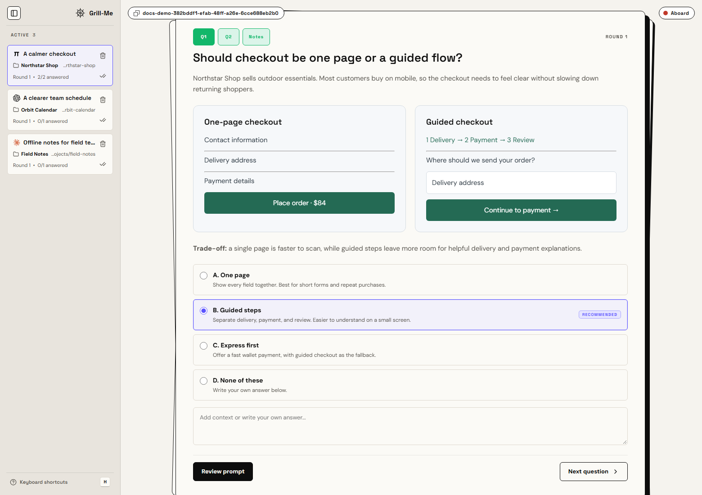
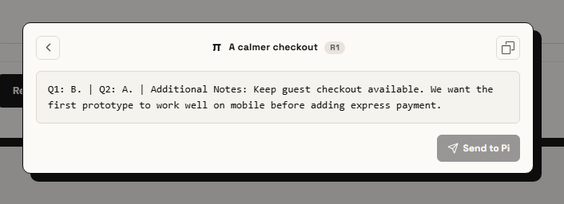
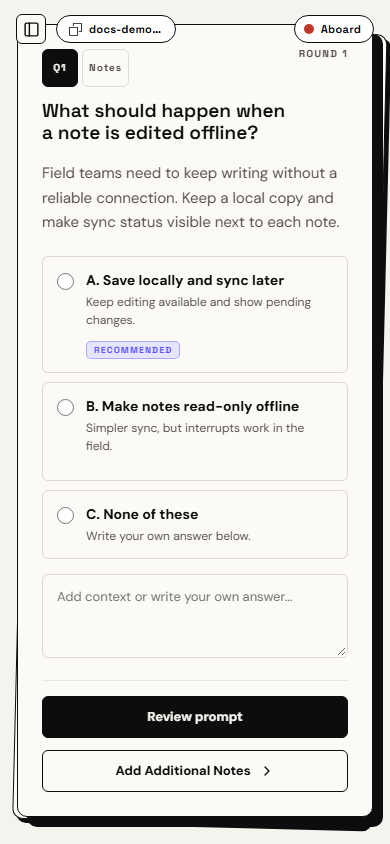

# Grill me in cloud

Platforms: **Claude Code, ChatGPT, Pi**.

Turn a plan or design into a visual interview on your own private board. Compare options, explore explanations, and answer questions from your computer or phone. Each round builds on your answers until you and the agent agree on what to build.

## When to use it

Use Grill me in cloud before building a feature with several connected decisions, especially when a visual comparison will make the choices easier to judge. The board can show images, diagrams, code excerpts, short video previews, and interactive explanations. Earlier rounds stay available as you work through the design.

If you prefer to keep the interview entirely in your conversation, use [grill-me](grill-me.md) instead.

## Install and connect

You need your own private board, a Vercel account, and a Supabase project. Follow the [private deployment setup](https://github.com/EmilienxD/harness/tree/main/apps/grill#personal-deployment) before connecting the tool. There is no shared public instance. Keep your deployment address and access code private.

Install for the agent you use. Run the matching command below, not all three. See [Get started](../../getting-started.md) for the full installer command and user-wide installation.

```bash
harness install grill-me-in-cloud --platform claude
harness install grill-me-in-cloud --platform chatgpt
harness install grill-me-in-cloud --platform pi
```

Restart Claude Code or ChatGPT after installation. In Pi, restart or run `/reload` and approve the installed project resources when prompted.

Set `HARNESS_GRILL_URL` to your deployment address and `HARNESS_GRILL_CODE` to its four-digit access code in the environment that launches your agent. Keep the code out of version control. You can also save private connection settings through [Configuration](../../configuration.md#hosted-grill-board).

Pi can return answers directly to its originating session. For direct delivery to Claude Code or ChatGPT, use [Aboard](../extensions/aboard.md). Copy and paste works without Aboard.

## Start an interview

Give the agent your proposal and the constraints you already know. For example:

- **Claude Code:** `/grill-me-in-cloud Review the checkout redesign`
- **ChatGPT:** `$grill-me-in-cloud Review the checkout redesign`
- **Pi:** `/grill-me-in-cloud Review the checkout redesign` or `/skill:grill-me-in-cloud Review the checkout redesign`

Open the private session link returned by the agent and enter your access code.



Here, the fictional Northstar Shop project compares a one-page checkout with guided steps. The explanation shows both layouts, with answer choices and a recommendation underneath. The sidebar keeps interviews for different projects separate, so you can return to another session at any time.

All screenshots on this page show the locally running app with fictional projects and sample rounds. No personal deployment or private project data is shown.

## Answer a round

1. Read the question, explanation, and recommendation. Explore any visual comparisons or interactive explanations.
2. Select an option or write a custom answer. Add a note when your reasoning matters. Your edits save automatically.
3. Continue through the questions. Use **Add Additional Notes** after the final question for context that applies to the whole round.
4. Choose **Review prompt** and check the combined answers before sending them.



The review shows the exact prompt you will return to the agent, including selected answers and additional notes. Use the copy button to paste it yourself. Direct sending becomes available when the matching agent session is connected.

## Send answers and continue

Choose the delivery method that matches your setup:

- **Send to Pi** returns answers to a connected Pi session. Wait for that session to be idle.
- **Send via Aboard** returns answers to a connected Claude Code or ChatGPT session.
- **Copy** lets you paste the reviewed prompt into the original conversation yourself.

Wait for delivery confirmation before sending the same answers again. The agent uses them to prepare the next round, keeping unanswered decisions open. Continue until the decisions are settled and you confirm the shared understanding.

## Answer from your phone

Open your own board on your phone to continue an interview away from your desk. You can read explanations, choose answers, and add context just as you would on a computer. Use the question buttons to move through the round. Your answers save automatically.



In this example, Field Notes is choosing how offline editing should work. The recommendation and custom-answer field remain available on the smaller screen.

## Images, videos, and private sessions

Ask the agent for media when it helps explain a decision. Images need no additional video software. Video publication requires FFmpeg on your computer. Keep clips short, with each video under 20 MiB. A round supports up to 30 assets totaling 50 MiB.

Edited diagrams can accompany reviewed answers. Follow the retrieval instructions shown with the prompt when needed.

Keep session links and your access code private. Each user hosts their own instance.

## If something goes wrong

If the board cannot connect, check your deployment address, access code, and network connection. If direct delivery is unavailable, your saved answers remain on the board. Copy the reviewed prompt into the original session instead.

If delivery expires, reconnect and review a new send rather than repeatedly submitting the old one. Start a new interview explicitly in a forked conversation rather than assuming an old board belongs to it.

Keep both the installed tool and your private board up to date.
